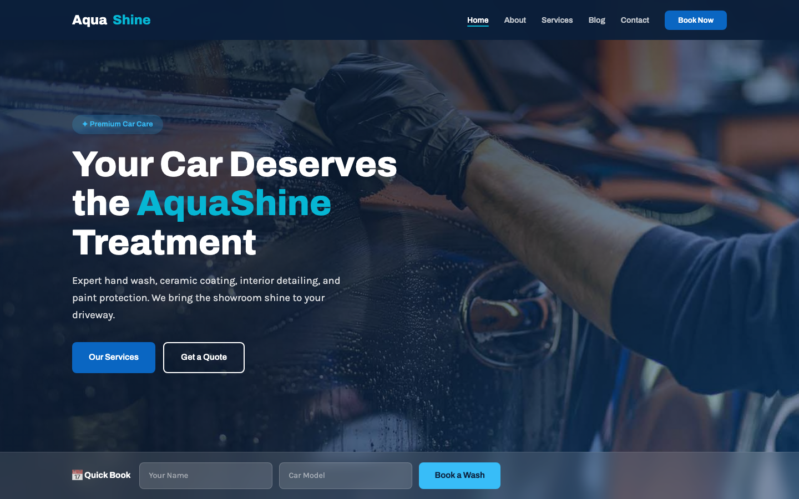

# 🚗 AquaShine — Premium Car Wash & Detailing Template

A clean, modern, fully responsive HTML template for a professional car wash and detailing business. Blue/cyan water-themed palette, full-width crossfading hero with a quick-book strip, services, team, testimonials, and a working contact form.

---

## 📸 Screenshot

## Design System

| Token | Value |
| --- | --- |
| Primary (Blue) | `#0A66C2` |
| Sky / Accent | `#38BDF8` |
| Navy (Dark) | `#0B1F3A` |
| Cyan | `#06B6D4` |
| Light Gray | `#F1F5F9` |
| White | `#FFFFFF` |
| Dark | `#111827` |
| Heading Font | Archivo (600 / 700 / 800) |
| Body Font | Karla (400 / 500) |

---

## Pages

| Page | Description |
| --- | --- |
| [index.html](index.html) | Home — crossfade hero, quick book, services, stats, about, team, testimonials |
| [about.html](about.html) | Our story, core values, and full team |
| [services.html](services.html) | Detailed services and transparent pricing plans |
| [blog.html](blog.html) | Car care tips, guides, and detailing insights |
| [contact.html](contact.html) | Contact form, business hours, info, and map |
| [404.html](404.html) | Friendly not-found page |

---

## Tech Stack

- **HTML5** — semantic, accessible markup
- **CSS3** — custom properties, Flexbox, Grid, `clamp()`, `aspect-ratio`
- **Vanilla JavaScript** — hero crossfade, scroll reveal, mobile nav, form validation, back-to-top
- **Google Fonts** — Archivo + Karla
- No frameworks, no build step, no external JS

---

## Images

All images live in `assets/img/` and are used as-is from the original source. See the table below:

| File | Used on |
| --- | --- |
| `carousel-1.jpg`, `carousel-2.jpg`, `carousel-3.jpg` | Hero crossfade (home) |
| `car-wash-website-template.jpg`, `single.jpg`, `about.jpg` | Service cards / details |
| `about.jpg` | About sections |
| `blog-1.jpg`, `blog-2.jpg`, `blog-3.jpg` | Blog cards |
| `team-1.jpg` – `team-4.jpg` | Team sections |
| `testimonial-1.jpg` – `testimonial-4.jpg` | Testimonials |
| `page-header.jpg` | Inner page headers + contact map |
| `post-1.jpg` – `post-5.jpg`, `user.jpg` | Small thumbnails / avatars |

---

**Template by uiuxlabz** — framework-free, responsive, production-ready.

---

### Let's Build Something Together 🚀

Have an idea? Let's create something amazing. [Start a project with us](https://tally.so/r/q4q1L9)
