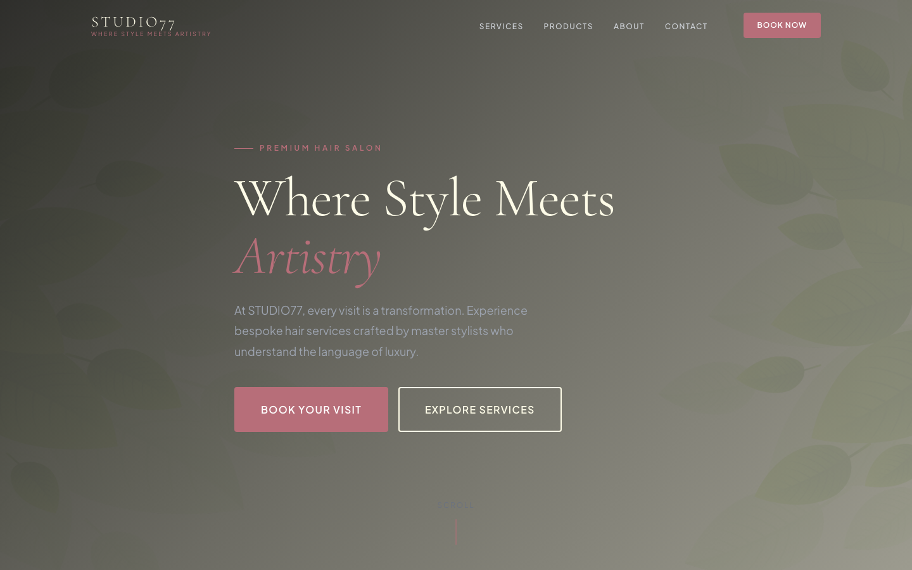

# STUDIO77 — Premium Hair Salon HTML Template

> *Where Style Meets Artistry.*

A premium, framework-free HTML template for a luxury hair salon. Built with semantic HTML5, modern CSS custom properties, and vanilla JavaScript. No dependencies. No build tools. Just open and go.

---

## 📸 Screenshot



## Pages

| Page | File | Description |
|------|------|-------------|
| Home | [index.html](index.html) | Hero, services, products showcase, testimonials, booking CTA |
| About | [about.html](about.html) | Brand story, philosophy, team profiles, values |
| Products | [products.html](products.html) | Filterable product grid with category tabs |
| Contact | [contact.html](contact.html) | Contact info, booking form, hours, location |

## Quick Start

1. Open `index.html` in any browser.
2. Or serve locally:
   ```bash
   # Python
   python3 -m http.server 8000

   # Node
   npx serve .
   ```

## Brand Identity

- **Name:** STUDIO77
- **Tagline:** Where Style Meets Artistry.
- **Colors:** Black `#0A0A0A` / Rose Gold `#B76E79` / Cream `#FEFCE8` / Charcoal `#1F2937`
- **Typography:** Cormorant Garamond (display) + Plus Jakarta Sans (body)

## Features

- **Pure HTML/CSS/JS** — zero framework dependencies
- **CSS Custom Properties** — full design system via `:root` tokens
- **Responsive** — 980px breakpoint (2-col) and 720px (1-col + mobile nav)
- **Scroll Reveal Animations** — IntersectionObserver-based fade/slide-in
- **Mobile Navigation** — slide-in panel with overlay
- **Product Filter** — category-based filtering on Products page
- **Form Validation** — client-side validation with toast notifications
- **Sticky Header** — transparent on hero, solid on scroll
- **Rose Gold Accents** — borders, hover states, and decorative elements throughout
- **Elegant Card Styles** — service cards, product cards, testimonial cards
- **Booking Form** — date picker styled to match the brand

## File Structure

```
hair-salon-html-template/
  index.html
  about.html
  products.html
  contact.html
  README.md
  assets/
    css/
      style.css
    js/
      main.js
    img/
      bg.png
      blog-1.jpg
      blog-2.jpg
      blog-3.jpg
      product-1.png
      product-2.png
      shampoo-1.png
      shampoo-2.png
      testimonial-1.jpg
      testimonial-2.jpg
      testimonial-3.jpg
```

## Customization

### Colors
Edit the CSS custom properties in `assets/css/style.css`:

```css
:root {
  --black: #0A0A0A;
  --rose-gold: #B76E79;
  --cream: #FEFCE8;
  --charcoal: #1F2937;
}
```

### Typography
Swap Google Fonts by updating the `@import` URL and `--font-display` / `--font-body` variables.

### Images
Replace files in `assets/img/` maintaining the same filenames, or update the `src` attributes in the HTML.

## Browser Support

- Chrome 80+
- Firefox 78+
- Safari 14+
- Edge 80+

## License

Free for personal and commercial use. Attribution appreciated.
