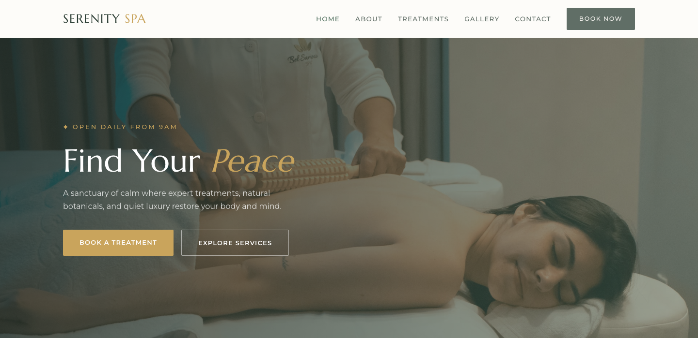

# 🧖 SERENITY SPA — Wellness Spa Template

A premium, framework-free HTML template for luxury spas and wellness retreats. The design features a sage + forest green palette with a warm gold accent, elegant serif typography, and a calm, botanical atmosphere that communicates relaxation and holistic care.

## 📸 Screenshot

## 🎨 Design System

| Token | Value | Usage |
|-------|-------|-------|
| `--sage` | `#7C9A8C` | Soft accents, section borders |
| `--forest` | `#2C3E35` | Headings, dark sections, primary |
| `--forest-dark` | `#21302A` | Footer, page heroes |
| `--moss` | `#4E6E5C` | Buttons, secondary accents |
| `--cream` | `#F7F5F0` | Soft section backgrounds |
| `--gold` | `#C9A45C` | CTAs, highlights, price tags |
| Headings | Marcellus | Elegant classical serif |
| Body | Montserrat | Refined modern sans |

## 📄 Pages

| Page | Description | Sections |
|------|-------------|----------|
| [index.html](index.html) | Home — full-width hero with crossfading spa photos | Signature services grid (6), Philosophy split, Stats bar, Team (4), Glassmorphism testimonials, Appointment CTA |
| [about.html](about.html) | Our story | Story split with layered images, Stats, Values cards, Team |
| [services.html](services.html) | Treatments & pricing | 6 signature service cards, Complete treatment menu with prices |
| [gallery.html](gallery.html) | Photo gallery | 14-image masonry-style gallery grid |
| [contact.html](contact.html) | Booking & contact | Reservation form (name, email, phone, treatment, date, notes), Contact card with hours & gift cards |

## ⚙️ Tech Stack

- **HTML5** — semantic markup, accessibility-first
- **CSS3** — custom properties, Grid, Flexbox, `clamp()`, `aspect-ratio`
- **Vanilla JS** — IntersectionObserver, hero crossfade, mobile nav, form validation
- **Fonts** — Google Fonts (Marcellus + Montserrat)

## 📁 Images

All images from the original spa template — 34 files in `assets/img/`:

- `carousel-1.jpg` through `carousel-3.jpg` — Hero crossfade (1920×1080)
- `services-1.jpg` through `services-6.jpg` — Service imagery (400×400)
- `about-1.jpg`, `about-2.jpg` — Philosophy split (600×800 / 300×200)
- `team-1.png` through `team-4.png` — Therapist portraits (456×547)
- `gallery-1.jpg` through `gallery-14.jpg` — Gallery grid (400×450)
- `testimonial-bg.jpg`, `appointment-background.jpg` — Background imagery (1920×1200)

---

**Template by uiuxlabz** — framework-free, responsive, production-ready.

---

### Let's Build Something Together 🚀

[https://tally.so/r/q4q1L9](https://tally.so/r/q4q1L9)
