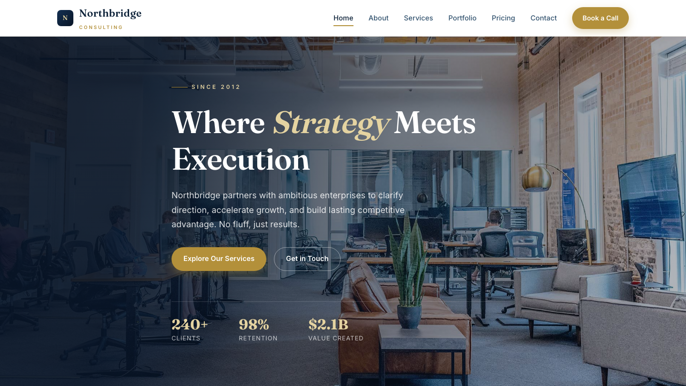

# Northbridge — Strategic Business Consulting

A premium, fully responsive HTML template for a strategic business consultancy. The design speaks in quiet authority — deep navy, warm brass accents, editorial serif headlines, and a confident grid — positioning the firm as the steady hand behind ambitious organisations.

## 📸 Screenshot

## Design System

| Token | Value |
|-------|-------|
| **Primary palette** | `--navy-900` `#0d2239`, `--navy-950` `#081527`, `--paper` `#f7f5f0` |
| **Accent** | `--brass` `#b3903a`, `--brass-soft` `#e4d3a1`, `--gold` `#c9a64d` |
| **Neutrals** | `--slate-400` `#7d93a8`, `--slate-300` `#b8c6d2`, `--ink` `#0e1a2b`, `--muted` `#5b6b7c` |
| **Display type** | `Fraunces` (serif, editorial) |
| **Body type** | `Inter` (sans, 400–600) |
| **Container** | 1200px max-width, centered |
| **Breakpoints** | ~980px (tablet), ~720px (mobile) |

## Pages

| Page | File | Description |
|------|------|-------------|
| Home | [index.html](index.html) | Editorial hero, advisory pillars, stats, partner quotes, CTA |
| About | [about.html](about.html) | Firm story, philosophy, guiding principles, team preview |
| Services | [service.html](service.html) | Strategy, operations, data & analytics, market expansion |
| Portfolio | [portfolio.html](portfolio.html) | Client engagements and outcomes |
| Pricing | [price.html](price.html) | Engagement models, FAQ, custom proposal CTA |
| Contact | [contact.html](contact.html) | Contact form with `[data-form]` validation, office details |

## Features

- **Framework-free** — pure HTML5, CSS3 (custom properties, Grid, Flexbox, `clamp()`), vanilla JavaScript
- **Boardroom aesthetic** — deep navy and brass editorial palette with Fraunces serif display type
- **Fluid responsive** — 3 breakpoints, no horizontal scroll on any viewport
- **Scroll reveal** — IntersectionObserver-powered `.reveal` animations (respects `prefers-reduced-motion`)
- **Mobile nav** — burger toggle with `aria-expanded` accessible pattern
- **Hero crossfade** — automatic 6s image transition via `.hero-bg img` + `.active` class
- **Form validation** — `[data-form]` hook with `.form-ok` / `.form-err` / `.show` toggle
- **Glyph icons** — custom inline SVG and character glyphs in markup, no icon library dependency
- **Original imagery** — production-quality corporate photography, no placeholders

## Tech Stack

- HTML5 + CSS3 (W3C-valid, semantic landmarks)
- Vanilla JavaScript (76-line IIFE, unmodified canonical build)
- Google Fonts (Fraunces + Inter)
- SVG favicon (inline data: URI)

## SEO

- Semantic HTML5 structure (`<header>`, `<nav>`, `<main>`, `<section>`, `<footer>`)
- Unique `<title>` and `<meta description>` per page
- `lang="en"` attribute, `charset="utf-8"`, viewport meta
- Alt text on all images
- Open Graph / Twitter Card meta tags on every page

## License

Free for personal and commercial use. Attribution appreciated but not required.

---

## Let's Build Something Together 🚀

[Book a free consultation](https://tally.so/r/q4q1L9)
