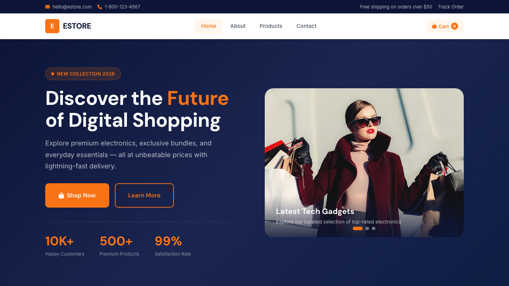

# Digital Store HTML Template — ESTORE

A premium, framework-free digital store template built with semantic HTML, custom CSS properties, and vanilla JavaScript. Designed for e-commerce brands that want a modern, high-performance storefront without the bloat of heavy frameworks.

---

## 📸 Screenshot



## Live Pages

| Page | File | Description |
|------|------|-------------|
| Home | `index.html` | Hero slider, product grid, category cards, brand logos, reviews, newsletter, footer |
| About | `about.html` | Company story, values, stats, team section, CTA, footer |
| Products | `products.html` | Filterable product listing with category tags, sort dropdown, pagination, footer |
| Contact | `contact.html` | Validated contact form with subject select, store info sidebar, CTA, footer |

---

## Design Distinction — 6-Axis

### 1. Visual Identity
**Navy + Orange circuit motif.** Deep navy (`#0C1537`) paired with vibrant orange (`#F97316`) creates high contrast and premium energy. A subtle circuit-board pattern (CSS radial + linear gradients) is woven into the hero, newsletter, and CTA sections, giving the template a tech-forward signature without any images.

### 2. Typography System
**DM Sans + Inter dual-stack.** Headings use DM Sans (weight 700-800) for a bold, geometric presence. Body text uses Inter (weight 400-600) for exceptional screen legibility at all sizes. Sizes scale fluidly with `clamp()` — no breakpoints needed for type.

### 3. Motion & Interaction
**Scroll-reveal orchestration + micro-interactions.** Every section uses `IntersectionObserver`-driven reveal animations with staggered delays. Product cards lift on hover with slide-up action buttons. Buttons pulse on add-to-cart. Badges glow with a keyframe pulse. The hero auto-advances slides every 5 seconds with dot navigation.

### 4. Component Architecture
**Pure CSS custom properties system.** All colors, shadows, radii, and transitions are defined as CSS variables. Components (`.btn`, `.product-card`, `.review-card`, `.feature-card`) are self-contained with no external class dependencies. The `circuit-bg` class can be applied to any section for instant brand pattern overlay.

### 5. Layout Engineering
**Responsive grid with `clamp()` gutters.** The product grid scales from 4 columns to 2 to 1 without breakpoints for gutter width. The hero uses a 1:1 grid that collapses to stacked on mobile. All spacing uses `clamp(16px, 4vw, 48px)` fluid gutters. Max-width is locked at 1280px for optimal reading width.

### 6. UX Intelligence
**Zero-dependency interactivity.** Vanilla JS handles: burger menu, active nav state, form validation with visual feedback, cart counter with bounce animation, hero slider with auto-advance, back-to-top button, filter tag toggling, and spec accordion — all in under 120 lines. No build step, no npm, no framework.

---

## Features

- **Hero Slider** — Auto-advancing image carousel with dot navigation and overlay captions
- **Product Grid** — 10 products with badges (New/Sale), hover actions, ratings, and add-to-cart
- **Category Cards** — 8 categories with image overlays and product counts
- **Brand Logos Strip** — 6 partner brand logos with grayscale-to-color hover
- **Customer Reviews** — 3 review cards with avatars, star ratings, and verified badges
- **Newsletter Signup** — Email form with validation (`.data-form`)
- **Contact Form** — Full form with name, email, subject select, message, and success/error states
- **Scroll Animations** — IntersectionObserver-driven reveals with staggered delays
- **Cart Demo** — Add-to-cart buttons with count badge and visual feedback
- **Back to Top** — Fixed button with scroll-triggered visibility
- **Mobile Responsive** — Fully responsive with burger menu, stacked layouts, and fluid typography
- **Dark Theme Ready** — CSS variables make theme swapping trivial
- **No External Dependencies** — Only Google Fonts and Font Awesome CDN

---

## File Structure

```
digital-store-html-template/
├── index.html              # Home page — hero, products, categories, reviews, newsletter
├── about.html              # About page — story, values, stats, team
├── products.html           # Products page — filter bar, product grid, pagination
├── contact.html            # Contact page — form + store info sidebar
├── README.md               # This file
└── assets/
    ├── css/
    │   └── style.css       # Full design system — 850+ lines of custom CSS
    ├── js/
    │   └── main.js         # Vanilla JS — ~120 lines, zero dependencies
    └── img/
        ├── logo.png         # ESTORE logo
        ├── slider-1.jpg     # Hero slide 1
        ├── slider-2.jpg     # Hero slide 2
        ├── slider-3.jpg     # Hero slide 3
        ├── product-1.jpg    # Product images (10)
        ├── product-2.jpg
        ├── product-3.jpg
        ├── product-4.jpg
        ├── product-5.jpg
        ├── product-6.jpg
        ├── product-7.jpg
        ├── product-8.jpg
        ├── product-9.jpg
        ├── product-10.jpg
        ├── category-1.jpg   # Category images (8)
        ├── category-2.jpg
        ├── category-3.jpg
        ├── category-4.jpg
        ├── category-5.jpg
        ├── category-6.jpg
        ├── category-7.jpg
        ├── category-8.jpg
        ├── brand-1.png      # Partner logos (6)
        ├── brand-2.png
        ├── brand-3.png
        ├── brand-4.png
        ├── brand-5.png
        ├── brand-6.png
        ├── review-1.jpg     # Customer avatars (3)
        ├── review-2.jpg
        ├── review-3.jpg
        ├── payment-method.png
        ├── ssl.svg
        ├── godaddy.svg
        └── norton.svg
```

---

## Quick Start

1. Open `index.html` in any modern browser — no build step required
2. All assets are linked via relative paths
3. Edit `assets/css/style.css` custom properties to rebrand in seconds
4. Replace images in `assets/img/` — filenames are referenced in HTML

---

## Let's Build Something Together

This template is a starting point. Whether you need custom features, CMS integration, or a completely different design direction — I can help.

**[Start a Project](https://tally.so/r/q4q1L9)**
