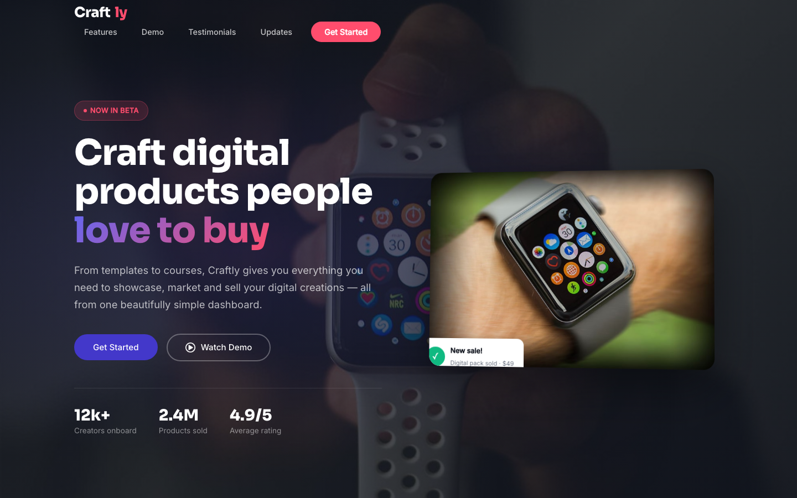

# 🛍️ Craftly — Digital Product Showcase &amp; SaaS Landing Page

A premium, single-page SaaS landing template for digital product creators. Craftly pairs a bold dark hero with a floating product mockup, a feature breakdown, an interactive video demo, customer testimonials, and a newsletter capture — all in clean, framework-free HTML/CSS/vanilla JS.

---

## 📸 Screenshot

## Design System

| Token | Value |
|---|---|
| --indigo | `#4338CA` |
| --coral | `#FF4D6D` |
| --dark | `#0B0F19` |
| --bg | `#F8FAFC` |
| --white | `#FFFFFF` |
| --gray | `#6B7280` |
| --mint | `#10B981` |
| Heading font | Sora (600/700/800) |
| Body font | Inter (400/500) |
| Radius | 12px / 20px |
| Breakpoints | 980px / 720px |

## Pages

| Page | Description |
|---|---|
| [index.html](index.html) | Single-page landing: hero, features, video demo, testimonials, newsletter, footer |
| [404.html](404.html) | On-brand "page not found" error page |

## Tech Stack

- Pure HTML5, CSS3 & vanilla JavaScript — no frameworks, no build step
- Google Fonts (Sora + Inter)
- Emoji favicon
- Mobile-first responsive layout (980px / 720px breakpoints)
- Reveal-on-scroll animations with `prefers-reduced-motion` support
- Sticky header with mobile slide-in navigation
- Back-to-top button & form validation included

## Images

All imagery lives in `assets/img/` — hero background, product mockup, feature dashboard, video poster, play buttons, four testimonial avatars, and a newsletter illustration. Swap them out to rebrand the template in minutes.

---

**Template by uiuxlabz** — framework-free, responsive, production-ready.

---

### Let's Build Something Together 🚀

Got a project in mind? Let's make it real.

[https://tally.so/r/q4q1L9](https://tally.so/r/q4q1L9)
