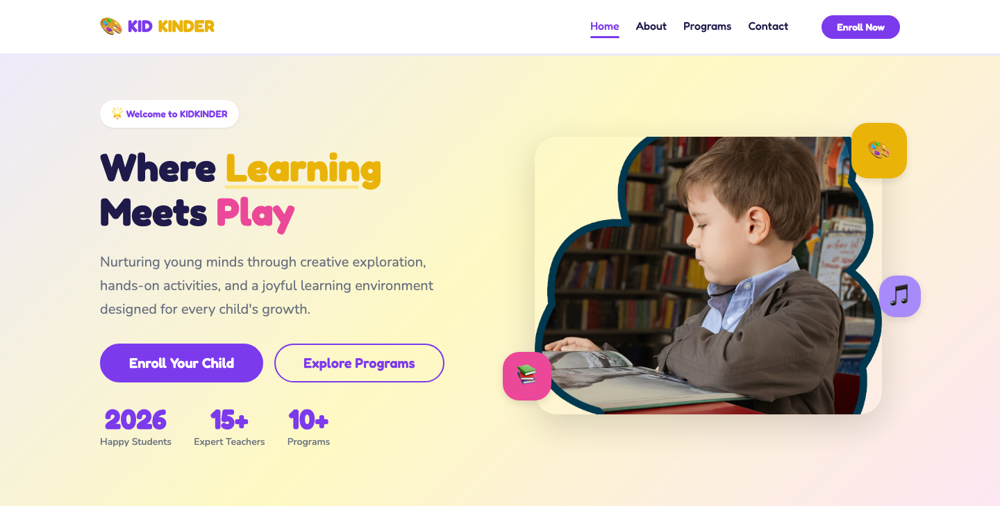

# KidKinder — Kids Education HTML Template

> Where Learning Meets Play

A colorful, playful HTML template for kids education, preschool, and learning centers. Built with pure HTML5, CSS3, and vanilla JavaScript — zero frameworks, zero dependencies.

## 📄 Pages

| Page | Description | Link |
|------|-------------|------|
| Home | Hero, programs overview, testimonials, enrollment CTA | [index.html](index.html) |
| About | School story, teaching staff, core values | [about.html](about.html) |
| Programs | Detailed program cards with age groups and schedules | [programs.html](programs.html) |
| Contact | Enrollment form, location, operating hours | [contact.html](contact.html) |

## ✨ Features

- **Playful Design** — Purple/yellow/pink color scheme with rounded, child-friendly elements
- **Fredoka + Nunito Typography** — Fun display font paired with clean body text
- **Program Cards** — Detailed cards showing age groups, activities, and schedules
- **Enrollment Form** — Contact form with validation and success/error states
- **Parent Testimonials** — Trust-building quotes from satisfied parents
- **Responsive Layout** — Works beautifully on desktop, tablet, and mobile
- **Scroll Animations** — IntersectionObserver-powered reveal effects
- **Mobile Navigation** — Hamburger menu with smooth transitions
- **Reduced Motion Support** — Respects `prefers-reduced-motion` setting

## 🚀 Quick Start

1. Open `index.html` in a browser — no build step needed
2. Replace images in `assets/img/` with your own
3. Edit content directly in the HTML files
4. Customize colors in `assets/css/style.css` via CSS custom properties

## 📸 Screenshot



## 🎨 Design System

### Colors
| Token | Value | Usage |
|-------|-------|-------|
| `--purple` | `#7C3AED` | Primary brand |
| `--yellow` | `#EAB308` | Accent / highlight |
| `--pink` | `#EC4899` | Secondary accent |
| `--dark` | `#1F2937` | Text / backgrounds |

### Typography
- **Headings:** Fredoka (Google Fonts) — playful, rounded
- **Body:** Nunito (Google Fonts) — clean, friendly

## 📁 File Structure

```
kids-education-html-template/
├── index.html          # Home page
├── about.html          # About page
├── programs.html       # Programs page
├── contact.html        # Contact & enrollment
├── assets/
│   ├── css/
│   │   └── style.css   # Full design system (~500+ lines)
│   ├── js/
│   │   └── main.js     # All interactions
│   └── img/            # Template images
└── README.md           # This file
```

## 🔧 Customization

1. **Colors:** Edit CSS custom properties in `:root` block of `style.css`
2. **Fonts:** Change Google Fonts `@import` URL and update `--font-display` / `--font-body`
3. **Content:** Edit text directly in HTML files
4. **Images:** Replace files in `assets/img/` keeping same filenames, or update `src` attributes

## 🌐 Browser Support

- Chrome 90+
- Firefox 88+
- Safari 14+
- Edge 90+

## 📄 License

Free for personal and commercial use. Attribution appreciated.

---

**Built with ❤️ for kids who love to learn**

[](https://tally.so/r/q4q1L9)
