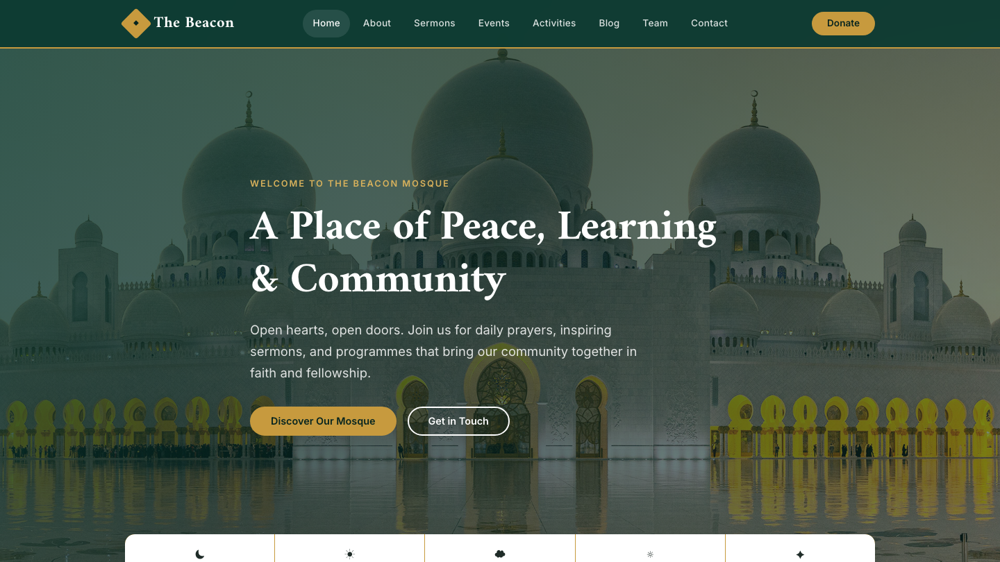

# The Beacon Mosque — Premium HTML Template

A warm, elegant, multi-page website template for a mosque and community centre — prayer times, sermons, events, activities, a blog, and a donation section, all in a single dependency-free HTML/CSS/vanilla-JS package.

## 📸 Screenshot

## Design System

| Token | Value | Notes |
| --- | --- | --- |
| Primary | `--teal-800` `#0b3a31` | Deep teal for headers, dark sections, buttons |
| Accent | `--emerald-600` `#17745f` | Emerald for links, highlights, hovers |
| Gold | `--gold-500` `#c79a3e` | Gold for CTAs, dividers, brand accents |
| Backgrounds | `--cream` `#f8f5ec`, `--light` `#f1f4f1`, `--white` `#ffffff` | Section-alternation rhythm |
| Text | `--ink` `#1f2c28`, `--ink-soft` `#44544f`, `--muted` `#6b7a75` | Clear reading hierarchy |
| Borders | `--border` `#d8e0dd` | Hairline dividers and cards |
| Display font | `Amiri` (Google Fonts) | Elegant, editorial headings |
| Body font | `Inter` (Google Fonts) | Crisp, readable UI text |
| Container | `1160px` max, fluid gutter | Responsive centered layout |
| Breakpoints | `980px` tablet / `720px` mobile | Stacking grids, mobile nav |
| Radius | `14px` → `32px`, pill | Soft, inviting shapes |

## Pages

All nine pages share the same header, navigation, and footer — consistent branding, active-link states, and a working mobile menu throughout.

| Page | File | What it contains |
| --- | --- | --- |
| Home | [index.html](index.html) | Hero, prayer-time strip, upcoming sermons & events, activities, blog preview, donation CTA |
| About | [about.html](about.html) | Our story, mission & values, community stats, photo gallery, how giving is used |
| Sermons | [sermons.html](sermons.html) | Weekly khutbahs and talks with images, dates, and descriptions |
| Events | [events.html](events.html) | Community calendar — Eid, iftars, interfaith gatherings, and more |
| Activities | [activities.html](activities.html) | Weekend school, youth nights, sisters' circle, food bank, and other programmes |
| Blog | [blog.html](blog.html) | Community articles with a working sidebar and newsletter signup |
| Team | [team.html](team.html) | Our imams, resident and guest scholars, and elected trustees |
| Testimonials | [testimonials.html](testimonials.html) | Community voices in numbers and heartfelt member stories |
| Contact | [contact.html](contact.html) | Visit info, enquiry form, map, and a dedicated donation section |

## Features

- Five daily prayer times in a strip on the home page and in the footer
- Nine fully styled pages with matching headers, nav, and footers
- Mobile-first responsive layout with a hamburger navigation menu
- Working contact and newsletter forms with client-side validation feedback
- Scroll-reveal animations (respects `prefers-reduced-motion`)
- Smooth-scroll anchor navigation and a back-to-top button
- Built-in donation section with anchor link support
- Original, locally bundled imagery — no external placeholders
- SEO-ready: semantic HTML5, unique titles, meta descriptions, Open Graph tags

## Tech Stack

- **HTML5** — semantic, accessible structure
- **CSS3** — custom properties, flexbox, grid, fluid typography, no frameworks
- **Vanilla JavaScript** — one small file for nav, reveals, forms, and micro-interactions
- **Google Fonts** — Amiri + Inter, loaded once and shared across all pages

No build step, no dependencies, no package manager — open any page and it just works.

## SEO Notes

- Each page carries a unique `<title>` and meta description.
- Open Graph tags (title, description, image, URL) are set on every page for clean social sharing.
- Semantic landmarks (`header`, `nav`, `main`, `section`, `footer`) and descriptive `alt` text support accessibility and crawlers.
- Mobile-friendly viewport configuration and responsive images throughout.

## License

Free to use for personal and community projects. The fictional organization, names, and imagery are original to this template. Attribution is appreciated but not required.

---

## Let's Build Something Together 🚀

[Book a free consultation](https://tally.so/r/q4q1L9)
