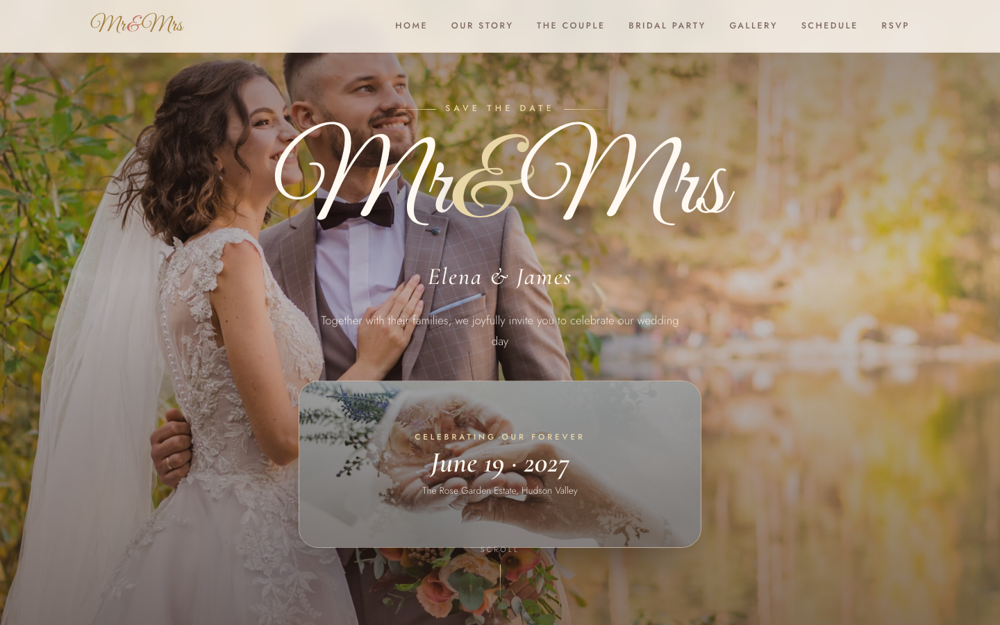

# 💍 Mr&Mrs — Wedding HTML Template

A premium, framework-free **wedding website** and **wedding invitation** template for couples who want to tell their love story beautifully. From the full-screen hero with a crossfading photo gallery and a "save the date" badge, through a love-story timeline, the bridal party, a photo gallery, and a day-of event schedule — right down to a working RSVP form — **Mr&Mrs** is an elegant celebration site you can customize and publish in an afternoon.

Crafted in pure HTML5, CSS3, and vanilla JavaScript. No frameworks, no build step, no dependencies — just open `index.html` and it works.

---

## 📸 Screenshot

## 🎨 Design System

A bespoke *Gilded Garden* palette — antique ivory, dusty rose, and aged gold — built on CSS custom properties so every color and font is one token away.

| Token | Value | Role |
| --- | --- | --- |
| `--ivory` | `#fff9f2` | Page background |
| `--ivory-deep` | `#f7ecdf` | Tinted section background |
| `--blush` / `--blush-deep` | `#f4dad2` / `#e8bfb4` | Soft accents, form feedback |
| `--rose` / `--rose-deep` | `#c17663` / `#96574a` | Accent ampersand, highlights |
| `--gold` / `--gold-deep` | `#c7a15b` / `#a27e3f` | Primary brand, buttons, hairlines |
| `--gold-soft` | `#e9d7a7` | Light-mode gold on dark |
| `--ink` / `--ink-soft` | `#43312b` / `#7e6a60` | Body text |

| Font | Fallback | Use |
| --- | --- | --- |
| Great Vibes | `cursive` | Script headlines & wordmark |
| Cormorant Garamond | `Georgia, serif` | Elegant headings, names |
| Jost | `system-ui, sans-serif` | Body, labels, buttons |

Signature details: double-matted gold photo frames, diamond-gem ornament dividers, hairline underline navigation, and a slow reveal-on-scroll motion language that respects `prefers-reduced-motion`.

---

## 📄 Pages

| Page | Description |
| --- | --- |
| [index.html](index.html) | Single-page celebration site — hero, love story, the couple, bridal party, gallery, schedule, RSVP |
| [404.html](404.html) | On-brand "lost down the aisle" error page |

**index.html sections**

- **Hero** — full-screen crossfading photo carousel, script "Mr&Mrs" headline, and a framed save-the-date badge
- **Our Story** — a four-chapter love-story timeline with alternating photos
- **The Couple** — framed portrait, plus the bride & groom round portraits
- **Bridal Party** — maid of honor, bridesmaids, best man, and groomsmen cards
- **Gallery** — a responsive photo grid with hover captions
- **Event Schedule** — the full celebration-day timeline on a photo backdrop
- **RSVP** — a validation-ready response form with success / error states
- **Footer** — contact details, quick links, auto-updating year, back-to-top

---

## ⚙️ Tech Stack

- **HTML5** — semantic landmarks (`header`, `main`, `section`, `footer`), Open Graph meta, emoji favicon
- **CSS3** — custom properties, CSS Grid, Flexbox, `clamp()` fluid type, `aspect-ratio`, `backdrop-filter`, `color-mix()`, `mask-image`
- **Vanilla JavaScript** — IntersectionObserver reveals, hero crossfade, smooth scrolling, mobile nav, footer year, RSVP validation (all in `assets/js/main.js`)
- **Google Fonts** — Great Vibes, Cormorant Garamond, Jost
- **Responsive** — breakpoints at 980px and 720px with a burger navigation on mobile
- **Accessible** — `prefers-reduced-motion` support, focus-visible states, aria labels

No Bootstrap. No Tailwind. No React. No build step — production-ready as-is.

---

## 📁 Images

All imagery ships with the template in `assets/img/` — original, high-quality source photos (never placeholder services):

| Group | Files | Used in |
| --- | --- | --- |
| Hero carousel | `carousel-1.jpg`, `carousel-2.jpg`, `carousel-3.png` | Hero crossfade |
| Date badge | `wedding-date-bg.jpg` | Hero badge & schedule backdrop |
| Love story | `story-1.jpg` … `story-4.jpg` | Timeline chapters |
| The couple | `about-1.jpg`, `bride.jpg`, `Groom.jpg` | Couple section |
| Bridal party | `bridesmaid-1.png`, `bridesmaid-3.png`, `bridesmaid-4.png`, `bridesmaid-team-2.png`, `Groomsmen-1.png`, `Groomsmen-3.png`, `groomsmen-2.png`, `groomsmen-4.png` | Party grid |
| Gallery | `gallery-1.jpg` … `gallery-8.jpg` | Photo grid |
| Backgrounds | `footer-bg.jpg`, `bg-flower.png`, `tamp-bg-1.png`, `team-1-bg.png`, `wedding-bg.png`, `attendance-bg.png` | Textures & decoration |

---

Template by uiuxlabz — framework-free, responsive, production-ready.

---

### Let's Build Something Together 🚀

Have a project in mind — a wedding site, a landing page, or something entirely different? Let's talk: [https://tally.so/r/q4q1L9](https://tally.so/r/q4q1L9)
