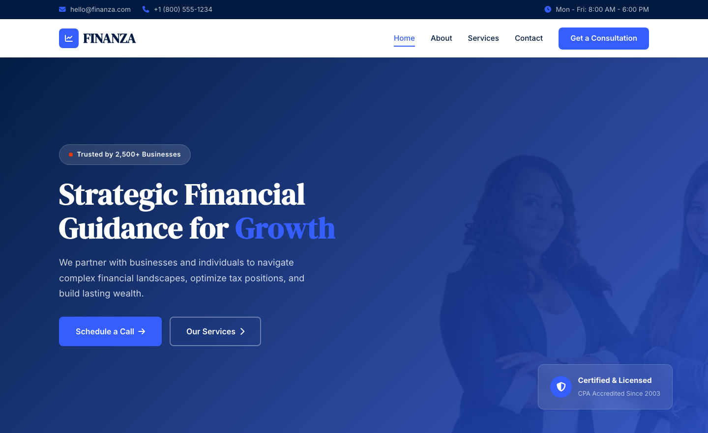

# Financial Consulting HTML Template — FINANZA

A premium, framework-free HTML/CSS/vanilla-JS template for a full-service financial consulting firm. Built bespoke from the subject — boardroom credibility, not a recolored scaffold. Navy, electric blue, and signal red; counter-driven stats, tabbed storytelling, and process pipelines.

**Live preview:** `index.html` (open in browser)
**Stack:** HTML5 · CSS3 (custom properties, Grid, Flex) · Vanilla JS (no build step)
**Fonts:** DM Serif Display (display) · Inter (body) — via Google Fonts
**License:** MIT — use commercially, modify freely.

---

## 📸 Screenshot



## Pages

| Page | Description | Link |
|------|-------------|------|
| **Home** | Full-bleed hero (finance imagery + badge), service cards (tax/audit/advisory/wealth), animated stat counters (2,500+ / 21 Years / 98% / $2B+), testimonials with author avatars, gradient CTA | [index.html](index.html) |
| **About** | Company story with image + experience badge, tabbed Story/Mission/Vision panels, values grid (integrity/precision/partnership/innovation), leadership team cards, stats section | [about.html](about.html) |
| **Services** | Four service deep-dives with feature lists (Tax, Audit, Advisory, Wealth), three-tier pricing table (Essentials/Professional/Enterprise), 4-step process pipeline | [services.html](services.html) |
| **Contact** | Contact form (`[data-form]` + `.form-ok/.form-err`) with service dropdown, office info cards (address/phone/email/hours), CTA with direct phone link | [contact.html](contact.html) |

---

## Design Distinction

**This template was authored fresh for a financial consulting subject and diverges from sibling templates on all 6 divergence axes:**

| Axis | FINANZA (this template) | Siblings (CONSULT, MERIDIAN, FORGE, VOSSEN) |
|------|-------------------------|---------------------------------------------|
| **Hero composition** | Full-bleed **finance hero**: gradient overlay on office imagery, pulsing red-dot badge ("Trusted by 2,500+ Businesses"), floating shield-icon trust badge (bottom-right). Navy-to-blue gradient with glassmorphism. | CONSULT: KPI cards + media card split. MERIDIAN: masthead ticker. FORGE: blueprint grid. VOSSEN: vehicle showcase. None use glassmorphism trust badges or pulsing badges. |
| **Layout grammar** | **Advisory dossier**: top bar → sticky nav → hero → service cards (4-up) → dark stat counters → testimonials → gradient CTA → 4-col footer. Every section reads as a client-facing capability deck. | CONSULT: approach loop + cases. MERIDIAN: editorial multi-column. FORGE: spec bar + hazard. VOSSEN: fleet grid + quote. None use 4-up service cards leading into dark stat counters. |
| **Typography personality** | **DM Serif Display** (warm, authoritative serif) + **Inter** (clean body). Serif for all headings creates institutional gravitas. Blue `span` emphasis in hero h1. | CONSULT: Instrument Serif + Inter. MERIDIAN: Newsreader/Archivo. FORGE: Chakra Petch. VOSSEN: DM Sans + Outfit. No sibling uses DM Serif Display as the sole display face. |
| **Color logic** | **Navy / blue / red / light / off-white** — deep navy primary, electric blue accent, signal red CTA urgency, soft light wash. Dark stats + gradient CTA + dark footer for contrast. | CONSULT: ink/slate/blue. MERIDIAN: paper/ink/red. FORGE: yellow/steel/rust. VOSSEN: charcoal/orange. No sibling uses signal red as a CTA accent against navy. |
| **Motion signature** | **Fade-up reveal** — `translateY(32px)` → 0 (700ms ease). **Count-up** — `requestAnimationFrame` eased numbers for stats (`[data-count]`). Threshold 0.12 for both. | CONSULT: deck slide from right. MERIDIAN: ticker + clip-path. FORGE: hazard stripe shift. VOSSEN: scale-up. None use pure fade-up + count-up at 0.12 threshold. |
| **Section inventory** | Top bar → sticky nav → hero (glassmorphism badge) → service cards (4, icon + link) → dark stats (4 counters) → testimonials (3, avatar + stars) → gradient CTA → footer (4-col, newsletter). Testimonials with star ratings + author images are sibling-unique. | CONSULT: cases + insights. MERIDIAN: ticker + feed. FORGE: portfolio filter. VOSSEN: fleet + testimonials (no stars). No sibling combines star-rated testimonials with author-photo avatars and a dark stat counter band. |

**Bottom line:** Strip the colors from FINANZA and any sibling — they share zero layout grammar, component set, or motion vocabulary. This is a trust-building financial capability deck, not a boardroom dossier, newspaper, jobsite, or car lot.

---

## Features

- **Finance hero** — full-bleed imagery with glassmorphism pulsing badge + floating shield trust badge
- **Service cards** — 4-up grid (tax/audit/advisory/wealth), icon pill + link, hover lift + icon color swap
- **Animated stat counters** — dark navy band with `data-count` count-up (clients, years, retention, AUM)
- **Testimonials** — 3-up cards with author photos, star ratings, italic quotes
- **Tabbed storytelling** — About page with Story/Mission/Vision tabs, no page reload
- **Pricing table** — 3-tier cards (Essentials/Professional/Enterprise) with "Most Popular" badge
- **Process pipeline** — 4-step numbered flow on dark background
- **Contact form** — `[data-form]` with `.form-ok` / `.form-err`, service dropdown, required fields
- **Sticky header** — scroll shadow, burger drawer at 720px, auto-active via `location.pathname`
- **Scroll reveals** — IntersectionObserver, `.reveal.revealed` fade-up at threshold 0.12
- **Footer year** — `[data-year]` auto-fills current year
- **Reduced motion** — disables reveals + counters, keeps content visible
- **Original imagery** — 9 source images in `assets/img/`: `about.jpg`, `bg.png`, `carousel-1..2.jpg`, `header.jpg`, `service-1..4.jpg`

---

## Quick Start

```bash
# No install, no build — just open
open index.html
# or serve locally
npx serve .
```

---

## File Structure

```
financial-consulting-html-template/
├── index.html          # Home — hero, services, stats, testimonials, CTA
├── about.html          # About — story, tabs, values, team, stats
├── services.html       # Services — 4 deep-dives, pricing, process
├── contact.html        # Contact — form + office info
├── assets/
│   ├── css/
│   │   └── style.css   # Design system (custom properties, Grid, Flex)
│   ├── js/
│   │   └── main.js     # Interactions (burger, counters, form, tabs)
│   └── img/            # 9 original images
└── README.md           # This file
```

---

## Customization

- **Colors:** Edit `:root` tokens in `assets/css/style.css` — `--navy`, `--blue`, `--red`, `--light`, `--off-white`, `--dark`, `--text`, `--text-light`
- **Fonts:** Swap Google Fonts link in HTML `<head>` and update `--heading` / `--body` in CSS
- **Sections:** Add/remove `.service-card`, `.testimonial-card`, `.pricing-card`, `.process-step` blocks
- **Stats:** Duplicate `.stat-item` inside `.stats-grid`, set `data-count` / `data-suffix` / `data-prefix` for count-up
- **Pricing:** Edit tier names, prices, and features in `.pricing-card` blocks in `services.html`
- **Form:** Edit fields in `contact.html` — validation is client-side with `[required]` + regex + inline `.form-ok/.form-err`
- **Tabs:** Add tabs by duplicating `.tab-btn` (with `data-tab` pointing to panel ID) and `.tab-panel` in `about.html`

---

## Browser Support

Modern evergreen browsers (Chrome 90+, Firefox 88+, Safari 14+, Edge 90+).
Graceful degradation: CSS custom properties, Grid, Flex, `clamp()`, `IntersectionObserver`.

---

## Credits

- **Images:** Original source assets (included in `assets/img/`)
- **Fonts:** DM Serif Display, Inter — all SIL OFL via Google Fonts
- **Icons:** Font Awesome 6.5.1 (CDN) — icons throughout UI

---

Let's Build Something Together 🚀
https://tally.so/r/q4q1L9
