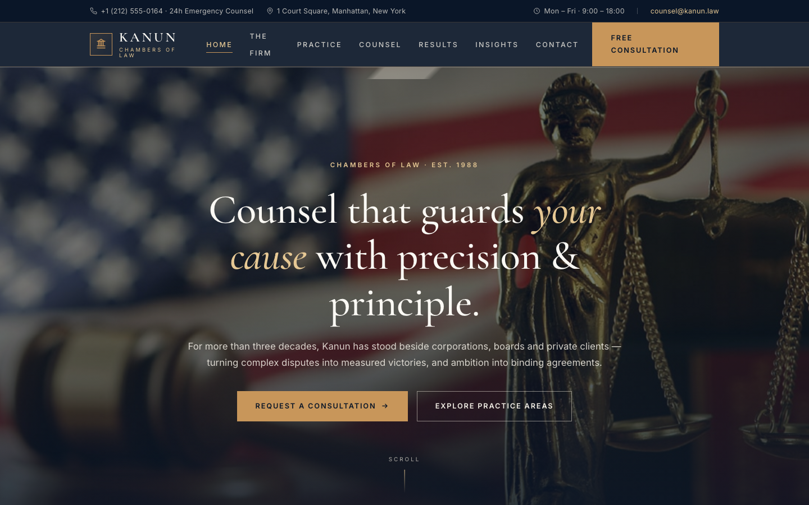

# Kanun — Chambers of Law Website Template

A premium, framework-free HTML template for a full-service law firm — deep ink navy, aged gold and warm parchment, with serif display type and a classical editorial voice.

## 📸 Screenshot

## Design System

| Token | Value | Usage |
| --- | --- | --- |
| `--ink` | `#0a1628` | Deep ink navy — primary dark surface, text on light |
| `--ink-2` | `#0f2036` | Raised ink — footer, hover states |
| `--gold` | `#c8965a` | Aged gold — accents, buttons, rules, hover |
| `--gold-soft` | `#e6c894` | Pale gold — eyebrows, labels on dark |
| `--stone` | `#f5f1e8` | Warm stone — alternating section background |
| `--paper` | `#fbf9f4` | Parchment — page background, cards |
| `--line` | `#e0d8c6` | Hairline — borders, dividers |
| `--text` | `#3d4350` | Body text on light surfaces |
| `--text-soft` | `#6b7280` | Muted text — secondary copy |

**Typography**

| Role | Typeface | Notes |
| --- | --- | --- |
| Display / headings | Cormorant Garamond (400–700, incl. italics) | `--font-display` |
| Body / UI | Inter (400–700) | `--font-body` |

**Layout & breakpoints**

| Breakpoint | Behavior |
| --- | --- |
| Desktop (`> 980px`) | Multi-column grids, full topbar |
| Tablet (`≤ 980px`) | Grids collapse to two columns, topbar hidden |
| Mobile (`≤ 720px`) | Single column, off-canvas mobile menu |

## Pages

| Page | File | Purpose |
| --- | --- | --- |
| Home | [index.html](index.html) | Hero carousel, stats, practice areas, testimonials, team, insights, consultation form |
| About | [about.html](about.html) | Firm story, values, timeline, credentials |
| Practice | [service.html](service.html) | Six practice-area cards, approach, FAQ |
| Results | [portfolio.html](portfolio.html) | Case-result grid with outcomes, featured matters |
| Counsel | [team.html](team.html) | Attorney cards, how-we-work principles, careers |
| Insights | [blog.html](blog.html) | Featured article, article grid, briefing sign-up |
| Article | [single.html](single.html) | Single-post layout with prose styling, author box, share, pager |
| Contact | [contact.html](contact.html) | Contact cards, consultation form, map figure, FAQ |

## Features

- **Pure HTML5 + CSS3 + vanilla JavaScript** — no frameworks, no build step, no dependencies beyond Google Fonts.
- **Original photography** — all imagery ships from `assets/img/`; no external placeholders.
- **Consistent chrome** — identical header, topbar, footer and mobile menu across all eight pages.
- **Active-state navigation** — the current page is highlighted automatically.
- **Scroll-reveal animations** — `.reveal` elements fade up on scroll, with reduced-motion support.
- **Working form hooks** — every `[data-form]` form validates required fields and shows `.form-ok` / `.form-err` states.
- **FAQ accordions** — smooth expand/collapse on the Practice and Contact pages.
- **Animated counters** — stats bands count up on scroll into view.
- **Back-to-top button** — appears after scrolling, smooth-scrolls home.
- **Fully responsive** — from 4-column desktop grids to a single-column mobile layout.
- **SEO-ready** — semantic landmarks, unique titles and meta descriptions per page.

## Tech Stack

- **Markup:** Semantic HTML5
- **Styling:** Custom CSS3 with design tokens (CSS custom properties)
- **Interactivity:** Vanilla JavaScript (single canonical `assets/js/main.js` plus small per-page enhancers)
- **Fonts:** Google Fonts — Cormorant Garamond + Inter
- **Icons:** Inline SVG (no icon library)

## SEO Notes

- Each page ships a unique `<title>` and meta description tuned to the page's intent.
- Breadcrumb trails on every inner page aid navigation and context.
- Semantic elements (`header`, `nav`, `main`, `article`, `footer`) give search engines a clean content outline.
- Alt text is written descriptively on every image for accessibility and image search.
- Single canonical `index.html` target; all internal links resolve within the template folder.

## License

Free to use for commercial and personal projects. Attribution appreciated but not required. All photography is included with the template and may be reused with the site.

---

## Let's Build Something Together 🚀

[Book a free consultation](https://tally.so/r/q4q1L9)
