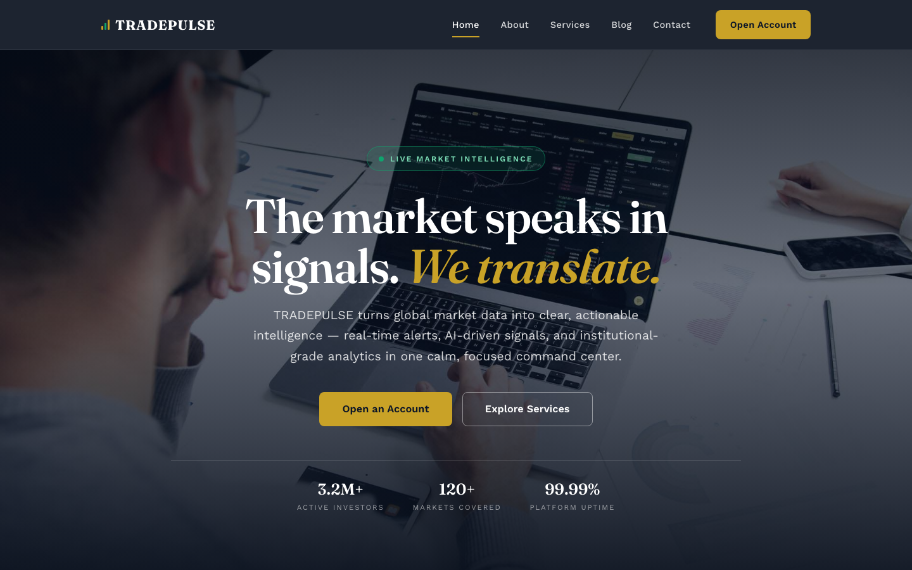

# 📈 TRADEPULSE — Stock Market Template

A premium, framework-free HTML template for stock-market intelligence platforms and investing products. The design pairs a deep-navy, terminal-inspired canvas with bullish emerald and gold accents, editorial Fraunces serif headlines, and a CSS-animated live market ticker — built for platforms that want to feel calm, credible, and institutional.

## 📸 Screenshot

## 🎨 Design System

| Token | Value | Usage |
|-------|-------|-------|
| `--navy` | `#0A1428` | Deep navy — header, hero, terminal & CTA bands |
| `--bull` | `#0FA46E` | Bullish emerald — positive deltas, accents, focus |
| `--gold` | `#C9A227` | Gold — CTAs, highlights, featured badges |
| `--bear` | `#E5484D` | Bearish red — negative deltas (used sparingly) |
| `--bg` | `#F5F7FA` | Light section backgrounds |
| `--card` | `#FFFFFF` | Cards, form fields |
| `--ink` | `#111827` | Body text |
| `--muted` | `#64748B` | Secondary text |
| `--line` | `#E5E9F0` | Hairline borders, dividers |
| Headings | Fraunces | Editorial serif — headlines, prices, stats |
| Body | Work Sans | Clean modern sans |

## 📄 Pages

| Page | Description | Sections |
|------|-------------|----------|
| [index.html](index.html) | Home — crossfade hero over a navy trading floor | Centered hero with live-metrics, CSS market ticker marquee, Stats band, About split with layered images, Terminal chart band, Services grid (6), Command-center dashboard, Team (4), Testimonials (3), CTA |
| [about.html](about.html) | Our story | Page hero, Story split with layered images + wide media band, Values (4), Stats band, Team (4), CTA |
| [services.html](services.html) | Products & pricing | Page hero, 6 product cards with pricing, 3 membership plans (Essential / Pro / Institutional), CTA |
| [blog.html](blog.html) | The Pulse — market briefings | Page hero, 6 typographic article cards (text-led editorial, no photos), CTA |
| [contact.html](contact.html) | Open an account | Page hero, Account form (name, email, phone, account type, message), Contact card with desk hours, CTA |
| [404.html](404.html) | Delisted page | Giant Fraunces 404, error copy, home + services links |

## ⚙️ Tech Stack

- **HTML5** — semantic markup, accessibility-first
- **CSS3** — custom properties, Grid, Flexbox, `clamp()`, `aspect-ratio`, CSS `@keyframes` ticker
- **Vanilla JS** — IntersectionObserver, hero crossfade, mobile nav, form validation
- **Fonts** — Google Fonts (Fraunces + Work Sans)

## 📁 Images

All images from the original stock template — 21 files in `assets/img/`:

- `carousel-1.jpg`, `carousel-2.jpg` — Hero crossfade (1920×1080 / 1920×1200)
- `service-1.jpg` through `service-6.jpg` — Product cards (600×400)
- `about-1.jpg`, `about-2.png`, `about-5.jpg` — Story split & terminal chart (600×400 / 600×400 / 600×300)
- `about-3.png`, `about-4.png` — Value cards (300×300 / 150×200)
- `header-1.png` — Command-center dashboard (600×400)
- `team-1.jpg` through `team-4.jpg` — Analyst portraits (300×300)
- `testimonial-1.jpg` through `testimonial-3.jpg` — Member avatars (100×100)

---

**Template by uiuxlabz** — framework-free, responsive, production-ready.

---

### Let's Build Something Together 🚀

[https://tally.so/r/q4q1L9](https://tally.so/r/q4q1L9)
