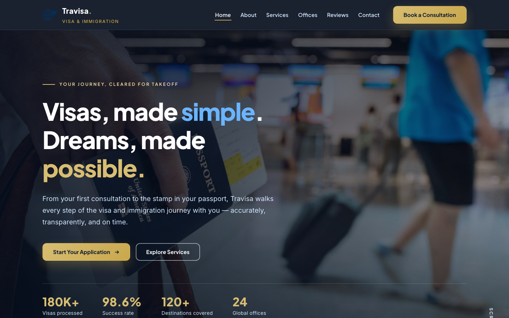

# Travisa — Visa & Immigration HTML Template

**Visas, made simple. Dreams, made possible.**

Travisa is a premium, framework-free HTML template for visa consultancies, immigration lawyers and relocation agencies. A deep-navy, passport-blue and gold design language — "cleared for takeoff" — with a full six-page site, token-driven CSS, a working consultation form and a completely original image set.

Open `index.html` and the whole experience takes off.

---

## What's inside

A complete, cohesive marketing site for a global visa & immigration consultancy — from the animated two-image hero on the homepage to a working contact form and a 24-office worldwide directory.

| Page | File | What it covers |
| ---- | ---- | -------------- |
| [Home](index.html) | `index.html` | Animated hero, info strip, service cards, process steps, counters, office preview, testimonials |
| [About](about.html) | `about.html` | Founder story, company values, mission, 20-year timeline |
| [Services](services.html) | `services.html` | Four flagship routes, the Travisa method, included extras, FAQ |
| [Offices](offices.html) | `offices.html` | Flagship office cards, animated network globe, full 24-office directory |
| [Reviews](testimonials.html) | `testimonials.html` | Featured story, six client testimonials, trust counters |
| [Contact](contact.html) | `contact.html` | Working consultation form, contact cards, regional office directory |

---

## 📸 Screenshot

## Design System

Every colour, typeface, spacing unit and shadow in the template is a CSS custom property, defined in `assets/css/style.css` under `:root`. Change a token once and the whole site follows.

### Palette

| Token | Value | Use |
| ----- | ----- | --- |
| `--navy-950` | `#060e1d` | Deepest footer / header ground |
| `--navy-900` | `#0b1a33` | Headings, dark sections, badges |
| `--navy-800` | `#122344` | Gradient start, button borders |
| `--navy-600` | `#24406e` | Gradient mid-tone |
| `--sky-700` | `#0f6ed8` | Link hover |
| `--sky-600` | `#1d82ea` | Links, ticks, buttons |
| `--sky-500` | `#3a9bff` | Primary action buttons |
| `--sky-300` | `#a2cfff` | Light accents on dark |
| `--sky-200` | `#d3e8ff` | Muted text on dark |
| `--gold-600` | `#b08a2e` | Eyebrow labels |
| `--gold-500` | `#c9a84c` | Stars, highlights, gold button |
| `--gold-400` | `#d8bd72` | Hero stats, gold gradient |
| `--gold-300` | `#e6d199` | Eyebrow on dark |
| `--ink` | `#101c30` | Body copy |
| `--slate` | `#5a6a80` | Muted copy |
| `--mist` | `#f4f8fc` | Soft section wash |
| `--white` | `#ffffff` | Surfaces |

### Typography

| Token | Value | Use |
| ----- | ----- | --- |
| `--font-display` | Plus Jakarta Sans (400, 600, 700, 800) | Headings, buttons, labels |
| `--font-body` | Inter (400, 500, 600, 700) | Body copy |
| `--fs-hero` | `clamp(2.5rem, 5.4vw, 4.25rem)` | Homepage hero |
| `--fs-h1` | `clamp(2.25rem, 4.2vw, 3.4rem)` | Page heroes |
| `--fs-h2` | `clamp(1.75rem, 3.2vw, 2.6rem)` | Section titles |
| `--fs-h3` | `clamp(1.2rem, 2vw, 1.5rem)` | Card titles |
| `--fs-lead` | `clamp(1.05rem, 1.4vw, 1.2rem)` | Lead paragraphs |

### Layout & motion

- **Container** — `--container: 1200px`, gutters `clamp(1.25rem, 4vw, 2.5rem)`
- **Spacing rhythm** — `--space-1` … `--space-10` (0.25rem → 7rem)
- **Radii** — `--radius-sm` 0.375rem, `--radius-md` 0.75rem, `--radius-lg` 1.25rem, `--radius-xl` 2rem, `--radius-pill` 999px
- **Elevation** — four shadows (`--shadow-sm` → `--shadow-lg`) plus a signature `--shadow-gold`
- **Motion** — `--ease: cubic-bezier(0.22, 1, 0.36, 1)`, durations 0.45s / 0.9s, scroll-reveal via IntersectionObserver, `prefers-reduced-motion` respected

---

## Tech Stack

- **HTML5** — semantic, accessible (landmarks, ARIA labels, focus-visible styling)
- **CSS3** — custom-property design tokens, `clamp()` fluid type, CSS grid, sticky header with backdrop blur
- **Vanilla JavaScript** — one small, dependency-free `assets/js/main.js` powering scroll reveal, mobile nav, hero crossfade, active-link highlighting, back-to-top, smooth anchors and the form handler
- **Fonts** — Google Fonts only: Plus Jakarta Sans + Inter
- **No frameworks, no build step, no CDNs** — open the files and it runs

---

## Images

All 18 images are original and shipped with the template in `assets/img/` — no placeholders, no hotlinked stock:

`Travisa.jpg`, `about-2.png`, `about-3.jpg`, `brand-logo.png`, `breadcrumb.png`, `carousel-1.jpg`, `carousel-2.jpg`, `office-1.jpg`, `office-2.jpg`, `office-3.jpg`, `office-4.jpg`, `service-1.jpg`, `service-2.jpg`, `service-3.jpg`, `service-4.jpg`, `testimonial-1.jpg`, `testimonial-2.jpg`, `testimonial-3.jpg`

---

## SEO & keywords

Every page ships with unique `title`, meta `description` and Open Graph tags, semantic heading order and descriptive alt text.

**Keywords:** visa and immigration consultants, tourist visa application, student visa help, work permit, permanent residence, citizenship services, Schengen visa, Express Entry, free visa consultation, embassy appointment booking, interview coaching, visa refusal re-application.

---

## License

MIT License — free for personal and commercial use. Attribution appreciated but not required.

---

### Let's Build Something Together 🚀

[https://tally.so/r/q4q1L9](https://tally.so/r/q4q1L9)
