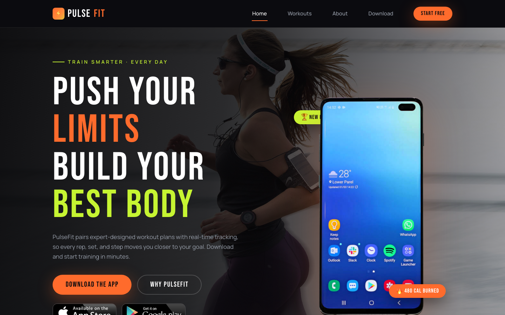

# 💪 PulseFit — Workout & Training App Landing Template

A bold, high-contrast landing template for a fitness and workout app. Built with semantic HTML5, modern CSS (custom properties, Grid, Flexbox, clamp()), and vanilla JavaScript — zero frameworks, zero build steps, ready to publish.

PulseFit features a full-width hero over a dark workout backdrop with a floating phone mockup and app-store badges, a feature grid, an about split with a checkmark feature list, and a newsletter CTA with form validation.

---

## 📸 Screenshot

## Design System

| Token | Value | Usage |
|-------|-------|-------|
| `--black` | `#0B0B0F` | Base background, dark surfaces |
| `--orange` | `#FF6B2C` | Primary accent, CTAs, highlights |
| `--lime` | `#C6F432` | Secondary accent, badges, icons |
| `--gray` | `#9CA3AF` | Body text, muted copy |
| `--white` | `#FFFFFF` | Headings, high-contrast text |
| `--font-display` | `Bebas Neue` | All headings — bold uppercase display |
| `--font-body` | `Manrope` (400/500/600) | Body copy, navigation, forms |

- Fluid type & spacing via `clamp()`
- Rounded-full pill buttons with glow shadows
- Scroll reveals with `IntersectionObserver` (0.12 threshold)
- Sticky blurred header, mobile burger menu, back-to-top button
- Responsive at `980px` and `720px`; respects `prefers-reduced-motion`

---

## Pages

| Page | File | Description |
|------|------|-------------|
| Home | [index.html](index.html) | Single-page landing — hero with phone mockup & store badges, features grid, about split, subscribe CTA, footer |
| 404 | [404.html](404.html) | Custom not-found page with branded header and footer |

---

## Tech Stack

- **HTML5** — semantic markup, ARIA labels
- **CSS3** — custom properties, Grid, Flexbox, clamp(), aspect-ratio
- **Vanilla JS** — IIFE pattern, IntersectionObserver, form validation, mobile nav
- **Google Fonts** — Bebas Neue + Manrope (preconnect + stylesheet)
- **No frameworks, no build tools** — open and go

---

## Images

| File | Used in |
|------|---------|
| `assets/img/header-bg.jpg` | Hero background |
| `assets/img/mobile.png` | Hero phone mockup |
| `assets/img/app-store.png` | App Store badge (hero + footer) |
| `assets/img/google-play.png` | Google Play badge (hero + footer) |
| `assets/img/fitness.jpg` | Workouts feature visual |
| `assets/img/about.jpg` | About split section |
| `assets/img/subscribe-bg.jpg` | Subscribe CTA background |

---

**Template by uiuxlabz** — framework-free, responsive, production-ready.

---

### Let's Build Something Together 🚀

Have a project in mind? We'd love to hear about it.

[https://tally.so/r/q4q1L9](https://tally.so/r/q4q1L9)
