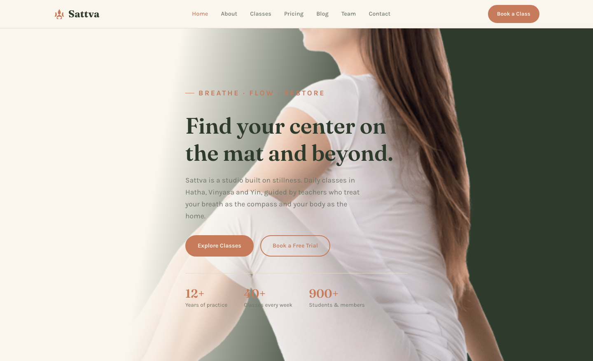

# Sattva Studio — Yoga Classes &amp; Wellness Retreats

A premium, fully responsive HTML template for a calming yoga studio. The design pairs moss greens, warm clay accents and sand-toned grounds with editorial Fraunces serif headlines — a grounded, breathable home for daily Hatha, Vinyasa, Yin and Kundalini classes.

## 📸 Screenshot

## Design System

| Token | Value |
|-------|-------|
| **Primary palette** | `--moss` `#3E4E3B`, `--moss-dark` `#2E3B2C`, `--sage` `#7C8B6F` |
| **Accent** | `--clay` `#C67B5B`, `--clay-dark` `#B06344`, `--clay-light` `#D9987A` |
| **Neutrals** | `--sand` `#EADFCE`, `--sand-light` `#F0E8DA`, `--cream` `#FAF6EE`, `--lark` `#FFFDF8` |
| **Display type** | `Fraunces` (serif, editorial) |
| **Body type** | `Karla` (sans, 400–700) |
| **Container** | 1180px max-width, centered |
| **Breakpoints** | ~768px (tablet), ~520px (mobile) |

## Pages

| Page | File | Description |
|------|------|-------------|
| Home | [index.html](index.html) | Hero, feature grid, class preview, pricing teaser, testimonials, journal |
| About | [about.html](about.html) | Studio story, values, teacher grid, stats |
| Classes | [class.html](class.html) | Class catalogue with schedule table and booking CTAs |
| Pricing | [price.html](price.html) | Membership plans, annual discount banner, FAQ |
| Blog | [blog.html](blog.html) | Journal grid of practice and wellness articles |
| Article | [single.html](single.html) | Full article layout with sequence guide |
| Team | [team.html](team.html) | Teacher grid and studio culture |
| Contact | [contact.html](contact.html) | Contact form with `[data-form]` validation, studio info cards |

## Features

- **Framework-free** — pure HTML5, CSS3 (custom properties, Grid, Flexbox, `clamp()`), vanilla JavaScript
- **Calming aesthetic** — moss greens, clay accents and warm sand grounds with editorial serif type
- **Fluid responsive** — 3 breakpoints, no horizontal scroll on any viewport
- **Scroll reveal** — IntersectionObserver-powered `.reveal` animations (respects `prefers-reduced-motion`)
- **Mobile nav** — burger toggle with `aria-expanded` accessible pattern
- **Hero crossfade** — automatic 6s image transition via `.hero-bg img` + `.active` class
- **Form validation** — `[data-form]` hook with `.form-ok` / `.form-err` / `.show` toggle
- **Glyph icons** — custom inline SVG icons and emoji glyphs in markup, no icon library dependency
- **Original imagery** — production-quality yoga photography, no placeholders

## Tech Stack

- HTML5 + CSS3 (W3C-valid, semantic landmarks)
- Vanilla JavaScript (76-line IIFE, unmodified canonical build)
- Google Fonts (Fraunces + Karla)
- SVG favicon (inline data: URI)

## SEO

- Semantic HTML5 structure (`<header>`, `<nav>`, `<main>`, `<section>`, `<footer>`)
- Unique `<title>` and `<meta description>` per page
- `lang="en"` attribute, `charset="utf-8"`, viewport meta
- Alt text on all images
- Open Graph / Twitter Card meta tags on every page

## License

Free for personal and commercial use. Attribution appreciated but not required.

---

## Let's Build Something Together 🚀

[Book a free consultation](https://tally.so/r/q4q1L9)
