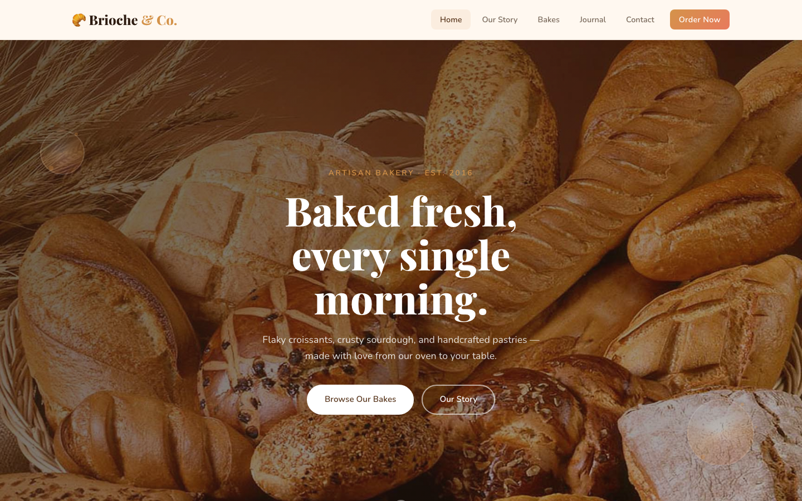

# 🥐 Brioche & Co. — Artisan Bakery & Pastry Shop

A warm, rustic multi-page website for an artisan bakery and pastry shop. Handcrafted sourdough, flaky croissants, and celebration cakes come to life through a cozy cream-and-terracotta palette, elegant serif headlines, and gentle bakery-inspired motion — bunting dividers, a floating pastry swirl, and a full-width hero crossfade.

Perfect for neighbourhood bakeries, patisseries, café-pastry hybrids, or any food business that wants to feel handmade, welcoming, and a little bit French.

## 📸 Screenshot

## 🎨 Design System

| Token | Value | Usage |
| --- | --- | --- |
| `--warm` | `#D4934A` | Golden amber — accent color, price text, kickers |
| `--brown` | `#5C3A21` | Deep chocolate — primary text, buttons, marquee band |
| `--cream` | `#FFF8F0` | Warm off-white — page background |
| `--coral` | `#E87A5D` | Terracotta — gradient partner, hearts, alerts |
| `--sage` | `#8BA38B` | Soft green — secondary tags, service buttons |
| `--dark` | `#2D1B10` | Espresso — footer, dark bands |
| `--font-heading` | Playfair Display | 600 / 700 / 800 — headlines, quotes, prices |
| `--font-body` | Nunito | 300 / 400 / 600 — body copy, buttons, forms |

## 📄 Pages

| Page | Description | Link |
| --- | --- | --- |
| Home | Hero crossfade, featured bakes, about, services, testimonials, team, journal, newsletter | [index.html](index.html) |
| About | Bakery story, milestones, values, and the team | [about.html](about.html) |
| Bakes & Pricing | Signature product details and custom-order pricing table | [products.html](products.html) |
| Journal | Three editorial baking posts | [blog.html](blog.html) |
| Contact | Enquiry form, contact info, and opening hours | [contact.html](contact.html) |
| 404 | Playful "batch came out empty" error page | [404.html](404.html) |

## 🛠 Tech Stack

- **HTML5** — semantic, accessible markup
- **CSS3** — custom properties, Grid & Flexbox, `clamp()`, `aspect-ratio`, backdrop-filter
- **Vanilla JavaScript** — hero crossfade, mobile nav, scroll reveal, back-to-top, form validation
- **Google Fonts** — Playfair Display + Nunito (no other external resources)
- No frameworks, no build step — open the HTML and it works

## 🖼 Images

All photography lives in `assets/img/` and is used directly from the original bakery shoot — no placeholder services:

- `carousel-1.jpg`, `carousel-2.jpg` — full-width hero crossfade
- `product-1.jpg`, `product-2.jpg`, `product-3.jpg` — featured bakes
- `about-1.jpg`, `about-2.jpg` — bakery story collage
- `service-1.jpg`, `service-2.jpg` — services
- `testimonial-1.jpg` – `testimonial-4.jpg` — customer avatars
- `team-1.jpg` – `team-4.jpg` — the baking team
- `bakery-website-template.jpg` — journal feature image
- `owl.video.play.png` — decorative play button

## 🚀 Getting Started

1. Download or clone the folder.
2. Open `index.html` in your browser — that's it.
3. To customize: edit the palette and fonts at the top of `assets/css/style.css`, swap images in `assets/img/`, and update copy directly in each page.

## 🧩 Customization

- **Branding** — change the logo text, colors, and fonts in one place (CSS variables).
- **Products** — duplicate a `.product-card` or `.product-details` block and swap the image and price.
- **Hours & contact** — update the footer and `contact.html` contact-info / hours-grid blocks.
- **Journal posts** — each post is a self-contained `.blog-post-card` with its own image or CSS illustration.

## 📈 SEO

Every page ships with a meta description, meta keywords, semantic headings, descriptive `alt` text, and a custom emoji favicon.

---
**Template by uiuxlabz** — framework-free, responsive, production-ready.

---
### Let's Build Something Together 🚀
[https://tally.so/r/q4q1L9](https://tally.so/r/q4q1L9)
