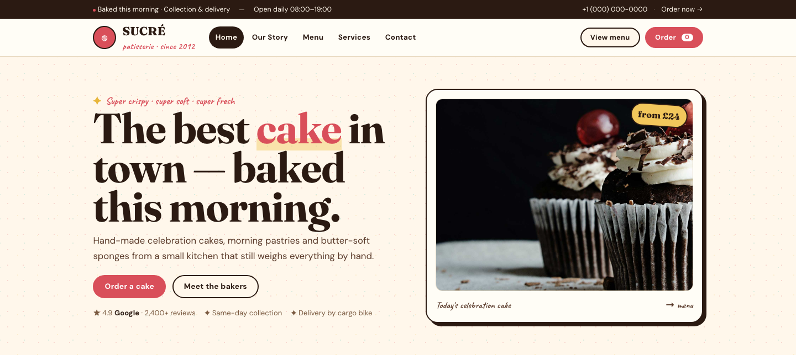

# Cake Shop HTML Template — SUCRÉ

A premium, framework-free HTML/CSS/vanilla-JS template for a patisserie and celebration-cake shop. Built bespoke from the subject — counter-display identity, not a recolored scaffold. Cream, cocoa, raspberry and butter; sprinkle dots, floating counter cards and sugar-pop reveals.

**Live preview:** `index.html` (open in browser)  
**Stack:** HTML5 · CSS3 (custom properties, Grid, Flex) · Vanilla JS (no build step)  
**Fonts:** Fraunces (display) · DM Sans (body) · Caveat (hand) — via Google Fonts  
**License:** MIT — use commercially, modify freely.

---

## 📸 Screenshot



## Pages

| Page | Description | Link |
|------|-------------|------|
| **Home** | Ribbon, patisserie hero (counter card with float), weekend-box offer band, about teaser, menu board (6 items), services trio, bakers, love notes, butter CTA | [index.html](index.html) |
| **Our Story** | Kitchen story, 4-step method, master bakers, in-numbers cards | [about.html](about.html) |
| **Menu & Pricing** | Celebration cakes (6) + counter pastries (6) — two menu boards with `data-add` cart demo | [menu.html](menu.html) |
| **Services** | Weddings & events, Saturday workshops, corporate boxes — plus workshop detail + love notes | [services.html](services.html) |
| **Contact & Orders** | Visit card + order form (date/guests/flavour/message) with inline validation | [contact.html](contact.html) |

---

## Design Distinction

**This template was authored fresh for a cake-shop subject and diverges from every sibling template on all 6 divergence axes:**

| Axis | SUCRÉ (this template) | Siblings (SOURA, OLIVO, VOSSEN, AERION, KORVA, MERIDIAN, FORGE) |
|------|-----------------------|------------------------------------------------------------------|
| **Hero composition** | Two-column **counter display**: headline with butter-underline + meta row on the left, **floating counter card** (rotated .6deg, 6px cocoa shadow, `float` 4.5s, price-tag rotated 4deg) on the right. Sugar sprinkle dot layers. | FORGE: blueprint grid + spec sheet. MERIDIAN: masthead + ticker + lead. Others: centered headline + CTA(s) over gradient/image. None use a floating product card or sprinkle-dot field. |
| **Layout grammar** | **Patisserie counter**: ribbon → hero counter → cocoa offer band (copy + media) → about frame (rotated -.7deg + butter note) → menu board (cream-2 top + 3-col item grid) → trio cards → team → quotes → butter band. Every section reads like a shop counter. | FORGE: spec bar → hazard stripe → proof bar → blueprint cards. MERIDIAN: editorial multi-column. Others: section-stack. None use a menu board or offer band. |
| **Typography personality** | **Fraunces** (soft, rounded display) + **DM Sans** (body) + **Caveat** (hand-kicker, notes). Raspberry em + butter underline on hero `em::after`. Handwriting for warmth. | FORGE: Chakra Petch (industrial all-caps, no serif). MERIDIAN: Newsreader/Archivo (newsprint). KORVA: Space Grotesk (lab). No sibling uses a handwriting face. |
| **Color logic** | **Cream / cocoa / raspberry / butter / sugar** — warm bakery paper, dark cocoa ink, raspberry accent, butter highlight, sugar pink. Rounded 14/22px, pill buttons, soft shadows. | FORGE: safety yellow / steel / rust (jobsite). MERIDIAN: newsprint paper/ink/accent red. KORVA: dark lab. None use cream-cocoa-raspberry as a system. |
| **Motion signature** | **Sugar pop** — `translateY(14px) scale(.98)` → none (soft pop). **Float** — `rotate(.6deg) translateY(-6px)` loop 4.5s on counter card. Sprinkle dots are static texture. | FORGE: hazard stripe shift (1.2s linear, `72px`). MERIDIAN: ticker + clip-path wipe. Others: fade-up `translateY(18–24px)` + cubic-bezier. |
| **Section inventory** | Ribbon → sitehead (sticky, blur) → hero counter → offer (cocoa) → about (frame+checks) → menu board (top+3-col) → trio (service cards) → team (3) → quotes (3) → butter CTA → cocoa footer. `data-add` / `data-cart-count` micro-cart is unique. | FORGE: portfolio filterbar + site grid + spec-list + steel team. MERIDIAN: ticker + lead + feed + rail + band + newsroom. Others: hero → features → stats → CTA. No menu boards, no offer band, no counter card. |

**Bottom line:** Strip the colors from SUCRÉ and any sibling — they share zero layout grammar, component set, or motion vocabulary. This is a patisserie counter, not a jobsite or a newspaper.

---

## Features

- **Ribbon** — cocoa bar with dot + hours + tel/CTA
- **Floating counter card** — rotated .6deg, 6px cocoa shadow, `float` 4.5s, butter price-tag rotated 4deg
- **Sugar sprinkle field** — three radial-gradient dot layers (raspberry/butter/mint) on hero
- **Offer band** — cocoa copy + cream media, raspberry sticker rotated -4deg
- **Menu boards** — cream-2 top + pill + 3-col item grid (1:1 images, price + `data-add`)
- **Micro-cart** — `data-add` → `data-cart-count` badge + "Added ✓" 900ms demo (no persistence)
- **Service trio** — 2px cocoa cards, hover lift + shadow
- **About frame** — rotated -.7deg + butter hand note, mint check circles
- **Team + quotes** — 2px cocoa cards, butter “ quote mark, butter-deep stars
- **Contact grid** — cocoa info + cream-3 form (2px cocoa shadow, 6px 6px)
- **Sticky header** — backdrop blur, pill nav, burger drawer at 720px
- **Scroll reveals** — IntersectionObserver, `.reveal` + `.d1`…`.d3`, sugar pop
- **Active nav** — auto-highlight via `location.pathname`
- **Footer year** — `[data-year]` auto-fills current year
- **Reduced motion** — disables float + reveals
- **Original imagery** — 15 source images from CakeZone (`assets/img/`): `hero.jpg`, `offer.jpg`, `cake-1..3.jpg`, `about.jpg`, `service.jpg`, `team-1..3.jpg`, `testimonial-1..4.jpg`, `bg.jpg`

---

## Quick Start

```bash
# No install, no build — just open
open index.html
# or serve locally
npx serve .
```

---

## File Structure

```
cake-shop-html-template/
├── index.html          # Home
├── about.html          # Our Story
├── menu.html           # Menu & Pricing
├── services.html       # Services
├── contact.html        # Contact & Orders
├── assets/
│   ├── css/
│   │   └── base.css    # Bespoke design system
│   ├── js/
│   │   └── main.js     # Bespoke interactions
│   └── img/            # 15 original CakeZone images
└── README.md           # This file
```

---

## Customization

- **Colors:** Edit `:root` tokens in `assets/css/base.css` — `--cream`, `--cocoa`, `--raspberry`, `--butter`, `--sugar`
- **Fonts:** Swap Google Fonts `<link>` in each HTML `<head>` and update `--font-display/--font-body/--font-hand`
- **Sections:** Add/remove `.menu-board`, `.trio`, `.team`, `.quotes`, `.offer` blocks
- **Menu:** Duplicate `.menu-item` inside `.menu-grid`, set image/price, add `data-add` to button for cart count
- **Form:** Edit fields in `contact.html` — validation is `checkValidity()` + inline `.form-ok`/`.form-err`

---

## Browser Support

Modern evergreen browsers (Chrome 90+, Firefox 88+, Safari 14+, Edge 90+).  
Graceful degradation: CSS custom properties, Grid, Flex, `clamp()`, `IntersectionObserver`.

---

## Credits

- **Images:** Original CakeZone source assets (included in `assets/img/`)
- **Fonts:** Fraunces, DM Sans, Caveat — all SIL OFL via Google Fonts
- **Icons:** Inline Unicode (✦ ★ ✓ ◍) — no icon font

---

Let's Build Something Together 🚀  
https://tally.so/r/q4q1L9
