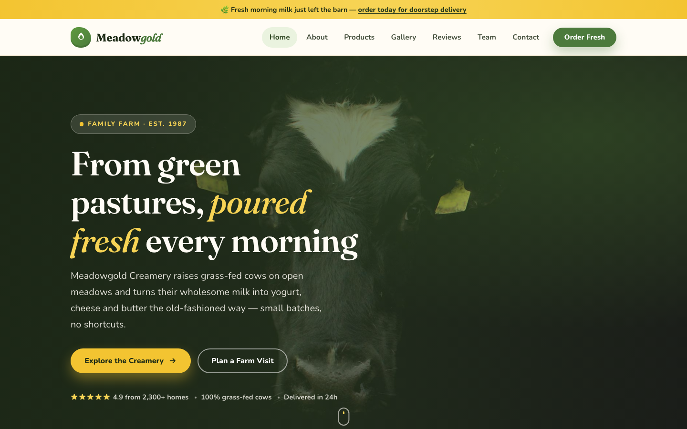

# Meadowgold Creamery — Fresh Grass-Fed Dairy, From Our Pasture to Your Table

A premium, fully responsive HTML template for a family-run dairy farm and creamery. The design leans into warm cream grounds, pasture greens and a butter-yellow accent, with editorial Fraunces serif headlines — a wholesome, pastoral home for dairy that's poured fresh and delivered daily.

## 📸 Screenshot

## Design System

| Token | Value |
|-------|-------|
| **Primary palette** | `--green-800` `#324a26`, `--green-600` `#4c7a3c`, `--green-500` `#5f9b3e` |
| **Accent** | `--butter-400` `#f3c431`, `--butter-300` `#f7d455`, `--green-200` `#d7e9c4` |
| **Neutrals** | `--cream-50` `#fffcf5`, `--cream-100` `#faf4e6`, `--cream-200` `#f2e8d2`, `--green-950` `#1c2a15` |
| **Display type** | `Fraunces` (serif, editorial, italic accents) |
| **Body type** | `Nunito` (sans, 400–800) |
| **Container** | 1200px max-width, centered |
| **Breakpoints** | ~980px (tablet), ~720px (mobile) |

## Pages

| Page | File | Description |
|------|------|-------------|
| Home | [index.html](index.html) | Hero, product highlights, story strip, gallery teaser, testimonials, CTA |
| About | [about.html](about.html) | Farm story, values, pasture promise, stats |
| Products | [product.html](product.html) | Milk, yogurt, cheese & butter catalogue |
| Gallery | [gallery.html](gallery.html) | Farm and product photography grid |
| Reviews | [testimonial.html](testimonial.html) | Customer stories and ratings |
| Team | [team.html](team.html) | The family and farmers behind the brand |
| Contact | [contact.html](contact.html) | Contact form with `[data-form]` validation, delivery info |
| 404 | [404.html](404.html) | On-brand error page with site navigation |

## Features

- **Framework-free** — pure HTML5, CSS3 (custom properties, Grid, Flexbox, `clamp()`), vanilla JavaScript
- **Pastoral aesthetic** — cream grounds, pasture greens, butter accents and editorial serif type
- **Fluid responsive** — 3 breakpoints, no horizontal scroll on any viewport
- **Scroll reveal** — IntersectionObserver-powered `.reveal` animations (respects `prefers-reduced-motion`)
- **Mobile nav** — burger toggle with `aria-expanded` accessible pattern
- **Hero crossfade** — automatic 6s image transition via `.hero-bg img` + `.active` class
- **Form validation** — `[data-form]` hook with `.form-ok` / `.form-err` / `.show` toggle
- **Glyph icons** — custom inline SVG icons in markup, no icon library dependency
- **Original imagery** — production-quality farm photography, no placeholders

## Tech Stack

- HTML5 + CSS3 (W3C-valid, semantic landmarks)
- Vanilla JavaScript (76-line IIFE, unmodified canonical build)
- Google Fonts (Fraunces + Nunito)
- SVG favicon (inline data: URI)

## SEO

- Semantic HTML5 structure (`<header>`, `<nav>`, `<main>`, `<section>`, `<footer>`)
- Unique `<title>` and `<meta description>` per page
- `lang="en"` attribute, `charset="utf-8"`, viewport meta
- Alt text on all images
- Open Graph / Twitter Card meta tags on every page

## License

Free for personal and commercial use. Attribution appreciated but not required.

---

## Let's Build Something Together 🚀

[Book a free consultation](https://tally.so/r/q4q1L9)
