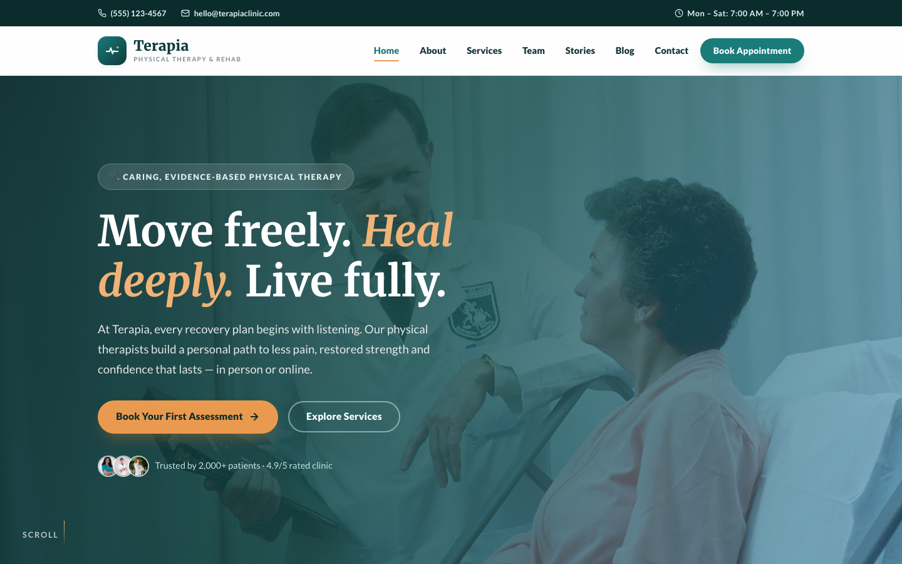

# 🩺 Terapia — Physical Therapy HTML Template

A premium, framework-free HTML website template for **Terapia**, a caring physical therapy and rehabilitation clinic. Built with pure HTML5, CSS3 custom properties, and vanilla JavaScript — no frameworks, no build step, no dependencies.

## Overview

Terapia is a complete, responsive 10-page website template designed for physical therapy, physiotherapy, and rehabilitation clinics. Every page is built around patient trust and recovery: from a hero crossfade and appointment booking to service showcases, team profiles, patient testimonials, and an educational blog. All images are original source files — no external placeholders.

## 📸 Screenshot

## 🎨 Design System

| Token | Value | Role |
|---|---|---|
| `--teal-600` | `#1B7B79` | Primary — healing teal accent |
| `--teal-900` | `#0E3B3C` | Deep teal — dark backgrounds, footer |
| `--apricot-500` | `#EA9A4E` | Warm accent — CTAs, highlights |
| `--sky-500` | `#3F9AC8` | Sky blue — secondary accent |
| `--ink` | `#123436` | Dark slate — headings |
| `--text` | `#45575A` | Soft slate — body copy |
| `--bg` | `#FBF8F3` | Warm ivory — page background |
| `--surface` | `#FFFFFF` | White — card surfaces |
| `--font-display` | Merriweather | Serif — headings, display |
| `--font-body` | Lato | Sans-serif — body text |

## 📄 Pages

| Page | Description |
|---|---|
| [`index.html`](index.html) | Home — hero crossfade, stats, features, services, video, testimonials, blog, CTA |
| [`about.html`](about.html) | Clinic story, mission & values, process, stats |
| [`services.html`](services.html) | 8 service cards with images, process steps |
| [`team.html`](team.html) | 4 therapist profiles with social links |
| [`appointment.html`](appointment.html) | Booking form with sidebar (hours, location, insurance) |
| [`testimonials.html`](testimonials.html) | Featured + 6 patient testimonial cards |
| [`blog.html`](blog.html) | Blog grid with 3 articles, newsletter signup |
| [`blog-single.html`](blog-single.html) | Full article with author box, tags, related posts |
| [`contact.html`](contact.html) | Contact info cards, send-message form, map placeholder |
| [`404.html`](404.html) | Custom 404 page with navigation |

## ⚙️ Tech Stack

- **HTML5** — semantic landmarks, meta/OG tags, emoji favicon
- **CSS3** — custom properties (design tokens), Grid, Flexbox, `clamp()`, `aspect-ratio`, `prefers-reduced-motion`
- **Vanilla JS** — Intersection Observer scroll reveal, burger nav, hero crossfade, form validation, smooth scroll, back-to-top, dynamic year, active nav state
- **Google Fonts** — Merriweather + Lato via `fonts.googleapis.com`
- **Responsive** — breakpoints at 980px and 720px (burger nav on mobile)

## 📁 Images

All images are stored in `assets/img/` and referenced directly from the source files — no external image URLs, no placeholders. The image set includes:

- 2 carousel images (hero crossfade)
- 8 service images
- 4 team member portraits
- 3 blog post images
- 2 about section images
- 1 testimonial image
- 1 video highlight image
- 1 preview/thumbnail

---

Template by **uiuxlabz** — framework-free, responsive, production-ready.

---

### Let's Build Something Together 🚀

[https://tally.so/r/q4q1L9](https://tally.so/r/q4q1L9)