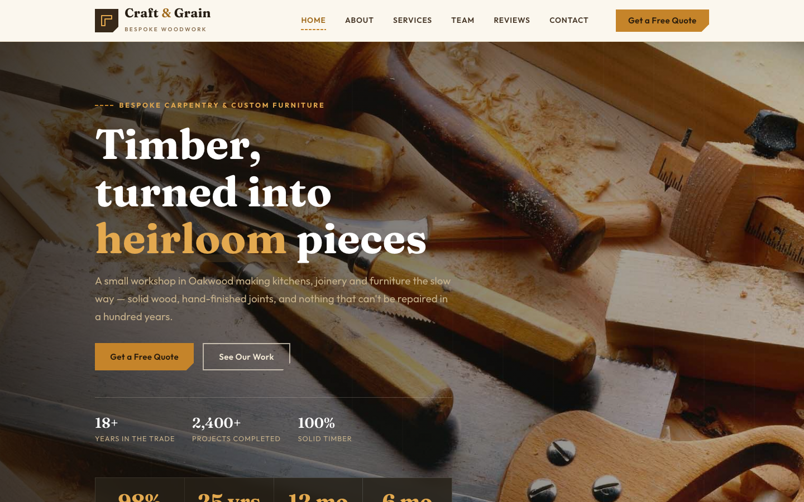

# Craft &amp; Grain — Bespoke Carpentry Workshop

A premium, framework-free HTML template for a bespoke carpentry and joinery workshop. Warm paper-cream grounds with deep walnut, amber and moss accents, driven by Fraunces display type and Outfit body text — an artisan, grain-first home for a workshop that has hand-built 2,400+ kitchens and fitted furniture with a lifetime guarantee.

## 📸 Screenshot

## Design System

| Token | Value |
|-------|-------|
| **Ground** | `--c-paper` `#fbf7ee` (light), `--c-paper-2` `#f3ebda` (section), `--c-walnut` `#37291a` (dark) |
| **Primary** | `--c-amber` `#c5842a` (honey amber), `--c-amber-deep` `#a06a1c` |
| **Secondary** | `--c-wood` `#6d4a2c` (raw timber), `--c-moss` `#74805a` |
| **Text** | `--c-ink` `#261d13`, `--c-body` `#5d4a34`, `--c-muted` `#8a7053` |
| **Display type** | `Fraunces` (serif, 400–700) |
| **Body type** | `Outfit` (sans, 400–700) |
| **Container** | 1180px max-width, centered |
| **Breakpoints** | ~980px (grid collapse), ~740px (mobile nav), ~520px (mobile) |

## Pages

| Page | File | Description |
|------|------|-------------|
| Home | [index.html](index.html) | Hero with crossfade, ticker tape, service preview, portfolio grid, process, testimonials, CTA |
| About | [about.html](about.html) | Workshop story, stats, material values |
| Services | [service.html](service.html) | Full service grid, 4-step process, guarantee band |
| Reviews | [testimonial.html](testimonial.html) | Client testimonials and trust stats |
| Team | [team.html](team.html) | Workshop crew and careers CTA |
| Quote | [quote.html](quote.html) | Free-quote form with `[data-form]` validation and how-it-works steps |
| Contact | [contact.html](contact.html) | Contact form with `[data-form]` validation, info cards, hours |
| 404 | [404.html](404.html) | On-brand error page with recovery links |

## Features

- **Framework-free** — pure HTML5, CSS3 (custom properties, Grid, Flexbox, `clamp()`), vanilla JavaScript
- **Artisan workshop aesthetic** — paper-cream grounds, honey amber and walnut palette, raw-timber and moss signals
- **Fluid responsive** — three breakpoints, no horizontal scroll on any viewport
- **Scroll reveal** — IntersectionObserver-powered `.reveal` animations (respects `prefers-reduced-motion`)
- **Mobile nav** — burger toggle with `aria-expanded` accessible pattern
- **Hero crossfade** — automatic 6s image transition via `.hero-bg img` + `.active` class
- **Ticker tape** — seamless looping timber-craft ticker with `:hover` pause
- **Outline numerals** — oversized `.num` displays with `text-stroke` for section depth
- **Counters** — stat rows with suffix styling for measurable results
- **Form validation** — `[data-form]` hook with `.form-ok` / `.form-err` / `.show` toggle
- **Original imagery** — production-quality woodworking photography, no placeholders

## Tech Stack

- HTML5 + CSS3 (W3C-valid, semantic landmarks)
- Vanilla JavaScript (canonical IIFE build)
- Google Fonts (Fraunces + Outfit)
- SVG favicon (inline data: URI)

## SEO

- Semantic HTML5 structure (`<header>`, `<nav>`, `<main>`, `<section>`, `<footer>`)
- Unique `<title>` and `<meta description>` per page
- `lang="en"` attribute, `charset="utf-8"`, viewport meta
- Alt text on all images

## License

Free for personal and commercial use. Attribution appreciated but not required.

---

## Let's Build Something Together 🚀

[Book a free consultation](https://tally.so/r/q4q1L9)

