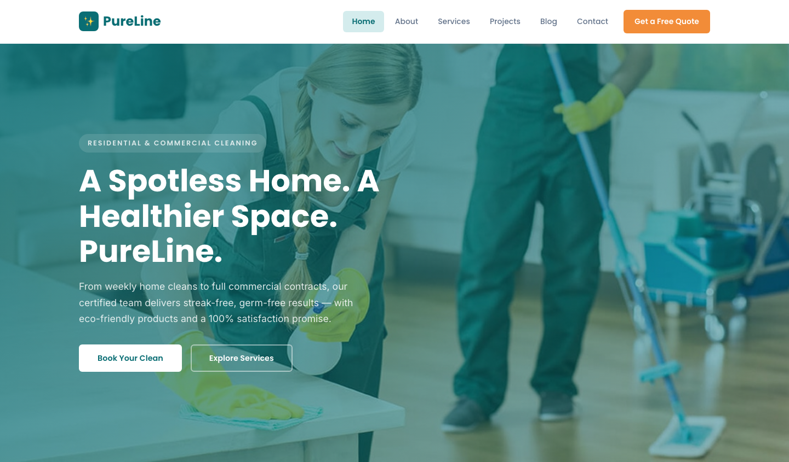

# PureLine — Professional Home & Office Cleaning Services

A premium, fully responsive HTML template for a professional cleaning services company. The design pairs a fresh teal core with warm citrus accents, airy whites, and crisp card-based layouts — projecting the reliability and sparkle that win repeat clients.

## 📸 Screenshot

## Design System

| Token | Value |
|-------|-------|
| **Primary palette** | `--pl-primary` `#0A6E74`, `--pl-primary-dark` `#085A5F`, `--pl-bg` `#F7F9FC` |
| **Accent** | `--pl-secondary` `#F28C38`, `--pl-accent` `#14B8A6` |
| **Neutrals** | `--pl-text` `#1E293B`, `--pl-text-muted` `#64748B`, `--pl-border` `#E2E8F0` |
| **Heading type** | `Poppins` (sans, 500–700) |
| **Body type** | `Inter` (sans, 400–500) |
| **Container** | 1200px max-width (900px narrow), centered |
| **Breakpoints** | ~980px (tablet), ~720px (mobile) |

## Pages

| Page | File | Description |
|------|------|-------------|
| Home | [index.html](index.html) | Hero, services preview, results, trust signals, pricing teaser |
| About | [about.html](about.html) | Company story, principles, team, why choose us |
| Services | [service.html](service.html) | Service catalogue, booking flow, testimonials |
| Projects | [project.html](project.html) | Fresh-space results gallery |
| Blog | [blog.html](blog.html) | Cleaning tips and guides |
| Article | [single.html](single.html) | Full blog article layout |
| Contact | [contact.html](contact.html) | Contact form with `[data-form]` validation, service areas |

## Features

- **Framework-free** — pure HTML5, CSS3 (custom properties, Grid, Flexbox, `clamp()`), vanilla JavaScript
- **Fresh-clean aesthetic** — teal primary, citrus accents, airy card surfaces
- **Fluid responsive** — 3 breakpoints, no horizontal scroll on any viewport
- **Scroll reveal** — IntersectionObserver-powered `.reveal` animations (respects `prefers-reduced-motion`)
- **Mobile nav** — burger toggle with `aria-expanded` accessible pattern
- **Hero crossfade** — automatic 6s image transition via `.hero-bg img` + `.active` class
- **Form validation** — `[data-form]` hook with `.form-ok` / `.form-err` / `.show` toggle
- **Glyph icons** — custom inline SVG icons in markup, no icon library dependency
- **Original imagery** — production-quality cleaning photography, no placeholders

## Tech Stack

- HTML5 + CSS3 (W3C-valid, semantic landmarks)
- Vanilla JavaScript (76-line IIFE, unmodified canonical build)
- Google Fonts (Poppins + Inter)
- SVG favicon (inline data: URI)

## SEO

- Semantic HTML5 structure (`<header>`, `<nav>`, `<main>`, `<section>`, `<footer>`)
- Unique `<title>` and `<meta description>` per page
- `lang="en"` attribute, `charset="utf-8"`, viewport meta
- Alt text on all images
- Open Graph / Twitter Card meta tags on every page

## License

Free for personal and commercial use. Attribution appreciated but not required.

---

## Let's Build Something Together 🚀

[Book a free consultation](https://tally.so/r/q4q1L9)
