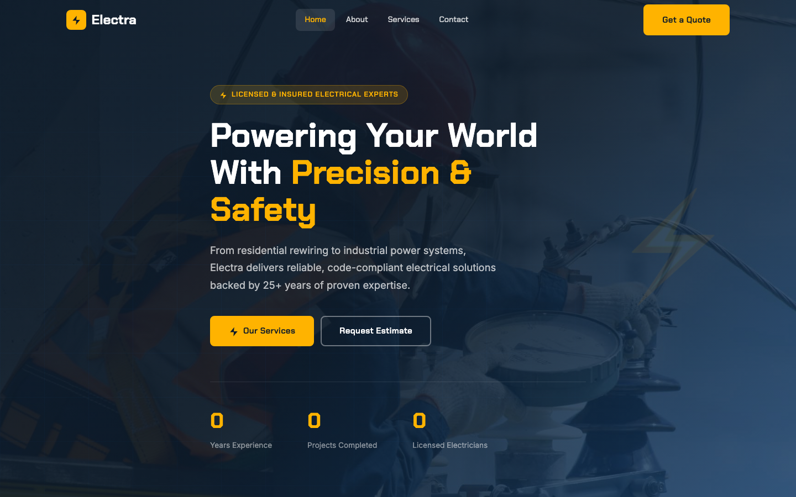

# Electrical Services HTML Template — ELECTRA

A premium, framework-free HTML/CSS/Vanilla JS template designed for electrical contractors and service businesses. Built with a bold industrial aesthetic, circuit-board visual language, and full mobile responsiveness.

**Live Feel:** Dark navy + electric yellow accent palette. Chakra Petch heading font. Circuit-grid overlays. Animated bolt motifs. Scroll-reveal animations. Zero dependencies.

---

## 📸 Screenshot



## Pages

| Page | File | Description |
|------|------|-------------|
| Home | `index.html` | Hero with stats counter, about section, 6 service cards, project gallery, testimonials, CTA banner |
| About | `about.html` | Company story, core values (6 cards), team grid (4 members), stats section, CTA |
| Services | `services.html` | 6 service cards, 3 detailed service breakdowns with checklists, 4-step process, CTA |
| Contact | `contact.html` | Contact form with validation (`data-form`, `.form-ok`/`.form-err`), info cards, map placeholder |

---

## Design Distinction — 6-Axis

1. **Circuit-Board Identity** — CSS grid overlays and radial gradients create a subtle circuit-board texture across hero sections, dark backgrounds, and CTA banners. The visual language reinforces the electrical trade without relying on stock imagery.

2. **Electric Yellow Accent System** -- A high-contrast yellow (`#FFB300`) is used sparingly but consistently: badge pills, active nav states, stat numbers, star ratings, and CTA buttons. It pops against the deep navy (`#0D1B2A`) ground.

3. **Bolt as Brand Motif** -- The lightning bolt SVG appears in the logo mark, hero decoration (animated pulse), button icons, and section labels. It is the single recurring symbol that ties every page together.

4. **Chakra Petch + Inter Pairing** -- Chakra Petch (geometric, industrial) for all headings and UI labels. Inter (clean, highly legible) for body text. The font pairing balances personality with readability.

5. **Scroll-Reveal Choreography** -- IntersectionObserver-driven reveals (`reveal`, `reveal-left`, `reveal-right`, `reveal-stagger`) bring content in from multiple directions with staggered timing, creating a cinematic feel without any animation library.

6. **Responsive Grid System** -- A fluid spacing scale (`clamp()`) and three-breakpoint responsive grid (desktop, tablet 980px, mobile 720px) ensure every section reflows gracefully. The burger menu and mobile nav provide a full-screen overlay on small screens.

---

## Features

- **Pure HTML/CSS/JS** -- No frameworks, no build tools, no dependencies. Drop onto any static host.
- **4 Complete Pages** -- Home, About, Services, Contact with consistent header/footer navigation.
- **Mobile-First Responsive** -- Fluid typography, responsive grids, burger menu with full-screen overlay.
- **Scroll Animations** -- IntersectionObserver-powered reveals with staggered children.
- **Contact Form Validation** -- Client-side validation with success/error feedback (`.form-ok` / `.form-err`).
- **Auto-Active Navigation** -- JS automatically highlights the current page in nav links.
- **Back to Top Button** -- Appears after scrolling, smooth-scrolls to top.
- **Copyright Year Auto-Update** -- `[data-year]` elements auto-fill the current year.
- **23 Original Images** -- All assets in `assets/img/`, no external image services.
- **Circuit-Board Visual Theme** -- CSS-only grid overlays and gradient patterns.
- **Accessibility** -- Semantic HTML, ARIA labels on interactive elements, focus states.

---

## File Structure

```
electrical-services-html-template/
├── index.html              # Homepage
├── about.html              # About page
├── services.html           # Services page
├── contact.html            # Contact page
├── README.md               # This file
└── assets/
    ├── css/
    │   └── style.css       # Complete design system + component styles
    ├── js/
    │   └── main.js         # Nav, scroll reveals, form validation, back-to-top
    └── img/
        ├── banner-img.jpg
        ├── about-1.jpg
        ├── about-2.jpg
        ├── carousel-1.jpg
        ├── header-1.jpg
        ├── header-2.jpg
        ├── commercial-1.jpg
        ├── commercial-2.jpg
        ├── commercial-3.jpg
        ├── residential-1.jpg
        ├── residential-2.jpg
        ├── residential-3.jpg
        ├── industrial-1.jpg
        ├── industrial-2.jpg
        ├── industrial-3.jpg
        ├── team-1.jpg
        ├── team-2.jpg
        ├── team-3.jpg
        ├── team-4.jpg
        ├── testimonial-1.jpg
        ├── testimonial-2.jpg
        └── testimonial-3.jpg
```

---

## Design Tokens

| Token | Value | Usage |
|-------|-------|-------|
| `--blue` | `#1565C0` | Primary brand color |
| `--blue-dark` | `#0D47A1` | Hover state |
| `--yellow` | `#FFB300` | Accent / CTA |
| `--dark` | `#0D1B2A` | Backgrounds, text |
| `--light` | `#F0F4FF` | Section alternation |
| `--font-heading` | Chakra Petch | All headings, labels |
| `--font-body` | Inter | Body text |

---

## Getting Started

1. Open `index.html` in a browser -- no server required.
2. Edit `assets/css/style.css` to customize colors, spacing, or typography.
3. Replace images in `assets/img/` with your own (keep same filenames or update references).
4. Update contact details in footer and `contact.html` info cards.

---

## Let's Build Something Together

This template is part of the **UIUXLabz** collection. Need a custom version for your business?

[Get in Touch](https://tally.so/r/q4q1L9)
