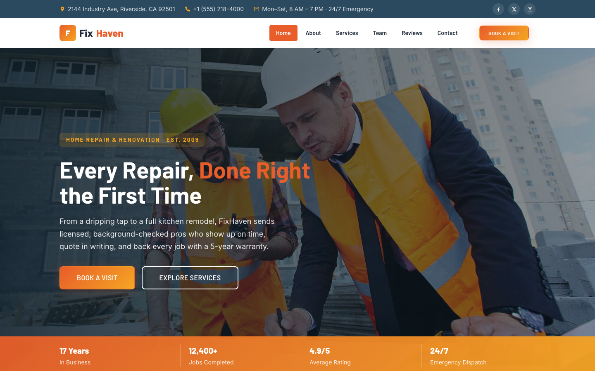

# FixHaven — Home Repair &amp; Renovation Services

A premium, framework-free HTML template for a licensed home repair and renovation company. Industrial burnt orange and steel blue palette with safety gold accents, driven by Barlow display type and Inter body text — a confident, trustworthy home for a crew that has completed 12,400+ jobs with a 5-year workmanship warranty.

## 📸 Screenshot

## Design System

| Token | Value |
|-------|-------|
| **Ground** | `--clr-bg` `#faf8f5` (warm off-white), `--clr-bg-dark` `#1a232e` (dark navy) |
| **Primary** | `--clr-primary` `#e85d2a` (burnt orange), `--clr-accent` `#f5a623` (safety gold) |
| **Secondary** | `--clr-secondary` `#2b4a5f` (steel blue), `--clr-secondary-dark` `#1d3343` |
| **Text** | `--clr-text` `#1f2937`, `--clr-text-light` `#6b7a8a`, `--clr-text-muted` `#9aabbb` |
| **Display type** | `Barlow` (sans, 600–900) |
| **Body type** | `Inter` (sans, 400–700) |
| **Container** | 1200px max-width, centered |
| **Breakpoints** | ~992px (grid collapse), ~768px (mobile nav), ~576px (mobile) |

## Pages

| Page | File | Description |
|------|------|-------------|
| Home | [index.html](index.html) | Hero with crossfade, strip stats, service preview, about, features, project gallery, testimonials, CTA |
| About | [about.html](about.html) | Company story, experience badge, stats, core values |
| Services | [service.html](service.html) | Full service grid (6 trades), 4-step process, guarantee stats |
| Team | [team.html](team.html) | Three crew members with socials, careers CTA |
| Reviews | [testimonial.html](testimonial.html) | Client testimonials and trust stats |
| Appointment | [appointment.html](appointment.html) | Book-a-visit form with `[data-form]` validation and what-happens-next guide |
| Contact | [contact.html](contact.html) | Contact form with `[data-form]` validation, info cards, map |
| 404 | [404.html](404.html) | On-brand error page with recovery links |

## Features

- **Framework-free** — pure HTML5, CSS3 (custom properties, Grid, Flexbox, `clamp()`), vanilla JavaScript
- **Trade-service aesthetic** — burnt orange, steel blue, warm industrial greys with safety gold accents
- **Fluid responsive** — three breakpoints, no horizontal scroll on any viewport
- **Scroll reveal** — IntersectionObserver-powered `.reveal` animations (respects `prefers-reduced-motion`)
- **Mobile nav** — burger toggle with `aria-expanded` accessible pattern
- **Hero crossfade** — automatic 6s image transition via `.hero-bg img` + `.active` class
- **Hero strip** — bold stat strip overlaying the hero section
- **Topbar** — contact info and social links with responsive show/hide
- **Stats cards** — bordered top stat display with hover lift effect
- **Service cards** — image + tag + body pattern with hover zoom and service-link
- **Team cards** — hover-reveal social icons, role label, bio
- **Testimonial cards** — quote mark, star rating, author avatar
- **Form validation** — `[data-form]` hook with `.form-ok` / `.form-err` / `.show` toggle
- **Newsletter form** — footer-embedded form with validation
- **Original imagery** — production-quality home repair and renovation photography, no placeholders

## Tech Stack

- HTML5 + CSS3 (W3C-valid, semantic landmarks)
- Vanilla JavaScript (canonical IIFE build)
- Google Fonts (Barlow + Inter)
- SVG favicon (inline data: URI)

## SEO

- Semantic HTML5 structure (`<header>`, `<nav>`, `<main>`, `<section>`, `<footer>`)
- Unique `<title>` and `<meta description>` per page
- `lang="en"` attribute, `charset="utf-8"`, viewport meta
- Alt text on all images

## License

Free for personal and commercial use. Attribution appreciated but not required.

---

## Let's Build Something Together 🚀

[Book a free consultation](https://tally.so/r/q4q1L9)