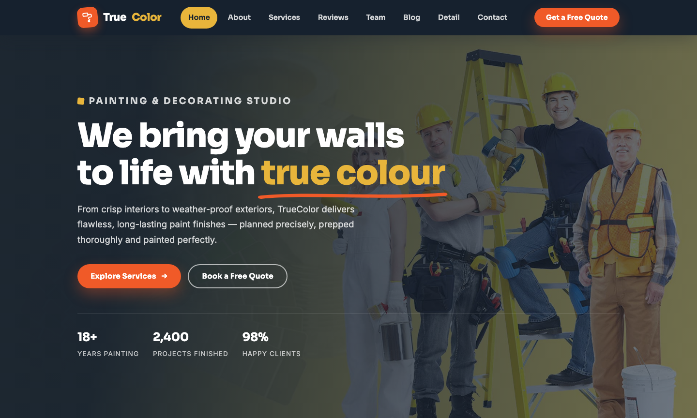

# TrueColor — Premium Painting &amp; Decorating Studio

A premium, framework-free HTML template for a professional painting and decorating studio. Warm paper-cream grounds with a confident terracotta accent, deep ink blues, and supporting teal and gold signals — driven by Sora display type and Inter body text — an artisan, trustworthy home for a studio that has repainted 2,400+ homes with a 10-year guarantee.

## 📸 Screenshot

## Design System

| Token | Value |
|-------|-------|
| **Ground** | `--paper` `#fff` (light), `--cream` `#f5f1e9` (section), `--cream-2` `#efe9dd` |
| **Primary** | `--accent` `#f05a28` (terracotta), `--accent-deep` `#d8481e` |
| **Secondary** | `--teal` `#0f766e` (deep teal), `--gold` `#e8b53b` (amber) |
| **Text** | `--ink` `#16212e`, `--slate` `#64748b`, `--slate-dark` `#475569` |
| **Display type** | `Sora` (sans, 500–700) |
| **Body type** | `Inter` (sans, 400–700) |
| **Container** | 1200px max-width, centered |
| **Breakpoints** | ~1024px (grid collapse), ~760px (mobile nav) |

## Pages

| Page | File | Description |
|------|------|-------------|
| Home | [index.html](index.html) | Hero with crossfade, swatch strip, services, process, stats, why-choose, testimonials, blog preview, CTA |
| About | [about.html](about.html) | Studio story, stats, core values, philosophy |
| Services | [service.html](service.html) | Full service grid, 4-step process, stats, free-quote CTA |
| Reviews | [testimonial.html](testimonial.html) | Six client testimonials, trust stats, book-your-quote CTA |
| Team | [team.html](team.html) | Three crew members, values, careers CTA |
| Blog | [blog.html](blog.html) | Featured article, post grid, sidebar categories and recent posts |
| Article | [detail.html](detail.html) | Full article layout with figure, blockquote, share buttons, more articles |
| Contact | [contact.html](contact.html) | Free-quote form with `[data-form]` validation, info tiles, map, FAQ accordion |

## Features

- **Framework-free** — pure HTML5, CSS3 (custom properties, Grid, Flexbox, `clamp()`), vanilla JavaScript
- **Artisan studio aesthetic** — paper-cream grounds, terracotta and deep-ink palette, teal and gold signals
- **Fluid responsive** — three breakpoints, no horizontal scroll on any viewport
- **Scroll reveal** — IntersectionObserver-powered `.reveal` animations (respects `prefers-reduced-motion`)
- **Mobile nav** — burger toggle with `aria-expanded` accessible pattern
- **Hero crossfade** — automatic 6s image transition via `.hero-bg img` + `.active` class
- **Swatch strip** — brand-led color swatch band echoing the studio's palette cards
- **Accordion FAQ** — `
`-based expandable questions with rotating icons
- **Form validation** — `[data-form]` hook with `.form-ok` / `.form-err` / `.show` toggle
- **Original imagery** — production-quality painting and interior photography, no placeholders

## Tech Stack

- HTML5 + CSS3 (W3C-valid, semantic landmarks)
- Vanilla JavaScript (canonical IIFE build)
- Google Fonts (Sora + Inter)
- SVG favicon (inline data: URI)

## SEO

- Semantic HTML5 structure (`<header>`, `<nav>`, `<main>`, `<section>`, `<footer>`)
- Unique `<title>` and `<meta description>` per page
- `lang="en"` attribute, `charset="utf-8"`, viewport meta
- Alt text on all images

## License

Free for personal and commercial use. Attribution appreciated but not required.

---

## Let's Build Something Together 🚀

[Book a free consultation](https://tally.so/r/q4q1L9)
