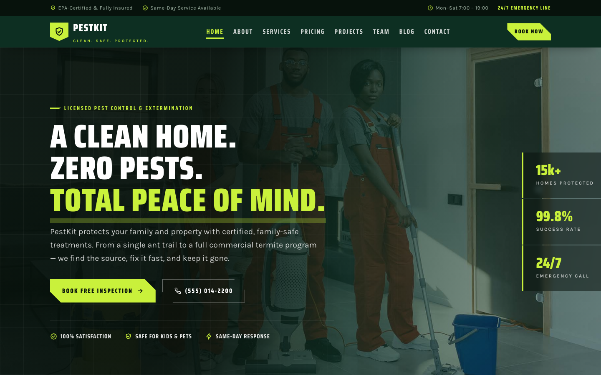

# PestKit — Professional Pest Control & Extermination Website Template

A complete, premium single-template website for a professional pest control and extermination company — certified, family-safe and built to convert visitors into bookings.

## 📸 Screenshot

## Design System

| Token | Value | Usage |
| --- | --- | --- |
| `--pk-ink` | `#07120c` | Near-black green — headings & footers |
| `--pk-pine` | `#0d2f22` | Primary deep green — nav & CTA bands |
| `--pk-moss` | `#16664a` | Mid green — accents & buttons |
| `--pk-lime` | `#c9f13b` | Signal accent — CTAs & highlights |
| `--pk-paper` | `#f2f5ee` | Page background |
| `--pk-card` | `#ffffff` | Card background |
| `--pk-danger` | `#ff5a3c` | Error states |
| `--pk-gold` | `#ffc857` | Star ratings |

**Typography**
- Display: *Saira Condensed* (600–900) — condensed, uppercase headlines
- Body: *Karla* (400–700) — clean, readable paragraphs
- Loaded via Google Fonts with `preconnect` for performance

**Breakpoints**
- Desktop: 1200px container, 4-column grids
- Tablet (≤980px): grids collapse to 2 columns, hero stat rail hides
- Mobile (≤720px): single column, hamburger nav, stacked forms

## Pages

| Page | File | Purpose |
| --- | --- | --- |
| Home | [index.html](index.html) | Hero carousel, services, process, projects, testimonials, blog preview |
| About | [about.html](about.html) | Company story, mission, values, stats, team preview |
| Services | [service.html](service.html) | 8 service cards, process steps, CTA |
| Pricing | [price.html](price.html) | 3 pricing plans, one-time price table, FAQ |
| Projects | [project.html](project.html) | Featured case study + 6 project cards, track-record stats |
| Team | [team.html](team.html) | Leadership & specialist cards, hiring section |
| Testimonials | [testimonial.html](testimonial.html) | Rating summary, 6 review cards, renewal stats |
| Blog | [blog.html](blog.html) | Featured guide, 6 article cards, newsletter signup |
| Contact | [contact.html](contact.html) | Info cards, booking form, service-area map |

## Features

- **9 fully linked pages** with consistent header, topbar and footer
- **Angular "clean-safety" aesthetic** — clip-path geometry, lime-on-dark signal accents, condensed display type
- **Scroll-reveal animations** powered by `IntersectionObserver` (reduced-motion friendly)
- **Sticky navigation** with active-state highlighting and a mobile hamburger menu
- **Hero crossfade carousel** with Ken Burns effect and a floating stat rail
- **Working booking form** with inline validation and success/error feedback
- **Pricing plans** with a highlighted "Most Popular" tier and an FAQ accordion
- **Fully responsive** — desktop, tablet and mobile layouts included
- **22 original images** for services, projects, team and testimonials

## Tech Stack

- **HTML5** — semantic, accessible markup (ARIA labels, skip-free header semantics)
- **CSS3** — custom-property design tokens, CSS grid, clip-path geometry, media queries
- **Vanilla JavaScript** — no dependencies, one small `main.js` for all interactivity
- **Google Fonts** — Saira Condensed + Karla

## SEO Notes

- Unique `<title>` and meta `description` on every page
- Keyword-optimized headings (H1 → H3 hierarchy) around pest-control terms
- Descriptive `alt` text on all images
- Semantic HTML (header, nav, main, section, article, footer) for clean crawlability
- Single canonical stylesheet keeps pages lightweight and fast

## License

Free to use for personal and commercial projects. Attribution to **uiuxlabz.com** is appreciated. No warranty expressed or implied.

---

## Let's Build Something Together 🚀

[Book a free consultation](https://tally.so/r/q4q1L9)
