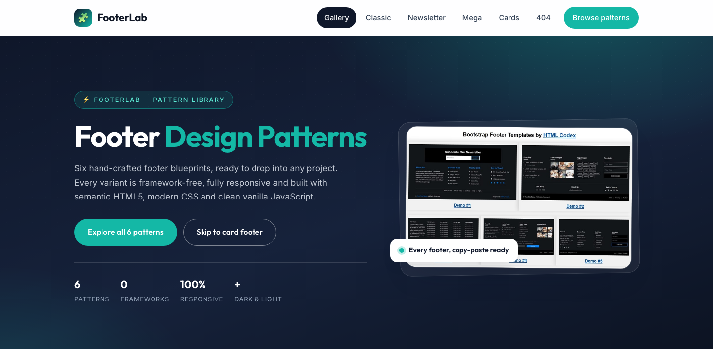

# 🧩 FooterLab — Footer Design Patterns

A curated gallery of **six production-ready footer patterns**, each rendered as a live, copy-paste-ready example. Framework-free, responsive and built with pure HTML5, CSS3 and a splash of vanilla JS.

Browse the patterns, hover the image cards, and drop any footer straight into your next project.

---

## 📸 Screenshot

## 🎨 Design System

| Token | Value | Usage |
| --- | --- | --- |
| `--ink` | `#111827` | Headings & primary text |
| `--navy` | `#0F172A` | Dark surfaces, hero & mega footer |
| `--teal` | `#14B8A6` | Brand accent, CTAs & hovers |
| `--slate` | `#475569` | Body copy on light surfaces |
| `--bg` | `#F8FAFC` | Page background & canvas |
| `--white` | `#FFFFFF` | Cards, inputs & light footers |
| `--line` | `#E5E7EB` | Borders & dividers |
| Headings | Outfit 500 / 600 / 700 | Display & section titles |
| Body | Inter 400 / 500 | Paragraphs & UI text |

## 📄 Pages

| Page | Description |
| --- | --- |
| [index.html](index.html) | Single-page showcase: hero, pattern index and six live footer variants |
| [404.html](404.html) | On-brand "footer not found" page |

## 🛠 Tech Stack

- Semantic **HTML5**
- Modern **CSS3** — custom properties, CSS Grid, Flexbox, `clamp()`, `aspect-ratio`
- **Vanilla JS** — scroll reveal, mobile nav, form validation, back-to-top
- Google Fonts: **Outfit** + **Inter**
- Zero frameworks, zero build step, zero external dependencies

## 🖼 Images

All imagery lives in `assets/img/` and is used from the original source — no placeholders, no external services.

- `bootstrap-footer-templates.jpg` — page hero image
- `demo-1.jpg` … `demo-5.jpg` — pattern index previews & brand marks
- `img-1.jpg` … `img-6.jpg` — card grid thumbnails & avatar marks

## ✨ The Six Patterns

1. **Classic Multi-Column** — brand block, 3 link columns, social icons (`#v1`)
2. **Newsletter CTA** — gradient email-capture band + quick links (`#v2`)
3. **Minimal Centered** — brand, one nav row, copyright + back-to-top (`#v3`)
4. **Mega Menu** — services, resources, company & legal columns (`#v4`)
5. **Social-Focused** — centered brand, large social icons, mini subscribe (`#v5`)
6. **Card / Image Footer** — image card grid + links + bottom bar (`#v6`)

---

**Template by uiuxlabz** — framework-free, responsive, production-ready.

---

### Let's Build Something Together 🚀

[https://tally.so/r/q4q1L9](https://tally.so/r/q4q1L9)
