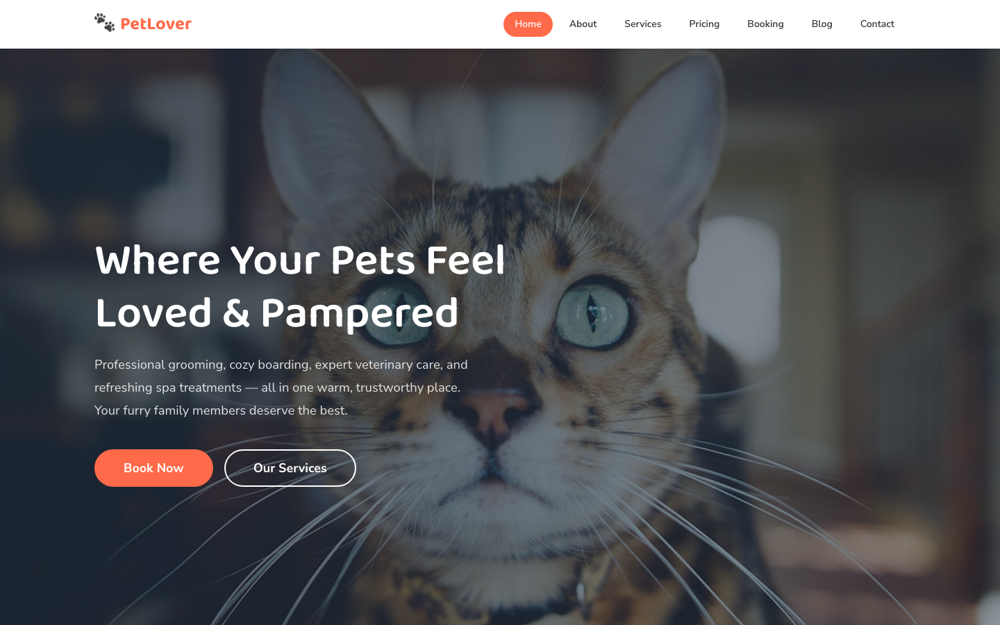

# 🐾 PetLover — Pet Care HTML Template

**PetLover** is a premium, fully responsive pet care & grooming website template built with pure HTML, CSS, and vanilla JavaScript — no frameworks, no build tools. Perfect for grooming salons, dog boarding facilities, veterinary clinics, and pet spas.

Warm, trustworthy, and modern: a cozy coral-and-teal palette, playful rounded typography, smooth scroll-reveal animations, and a fully functional booking flow out of the box.

---

## ✨ Features

- **8 complete pages** — Home, About, Services, Pricing, Booking, Blog, Blog Post, and Contact
- **Working contact & booking forms** — validation messages built in (no backend required)
- **Fully responsive** — mobile-first breakpoints at 980px and 720px, hamburger mobile nav
- **Animated sections** — scroll-reveal and stagger transitions with reduced-motion support
- **Token-driven design system** — every color, font, space, and radius is a CSS custom property
- **22 original images** included in the assets folder
- **SEO-ready** — meta descriptions, Open Graph tags, semantic markup

---

## 📸 Screenshot

## 🎨 Design System

### Colors

| Token | Value | Usage |
|-------|-------|-------|
| `--clr-primary` | `#ff6b4a` | Warm coral — buttons, links, accents |
| `--clr-primary-dark` | `#e0522f` | Coral hover / gradient depth |
| `--clr-primary-light` | `#ff8f72` | Coral highlights |
| `--clr-secondary` | `#1aab8a` | Teal — success details, checkmarks |
| `--clr-secondary-dark` | `#148a6f` | Teal hover |
| `--clr-secondary-light` | `#4ec4a8` | Teal highlights |
| `--clr-accent` | `#f6c445` | Gold — badges, "Popular" tag |
| `--clr-accent-light` | `#fde29b` | Gold soft tone |
| `--clr-bg` | `#fffaf7` | Warm cream page background |
| `--clr-bg-alt` | `#fff4ed` | Alternate section background |
| `--clr-bg-dark` | `#1a2a3a` | Deep navy — footer, banners |
| `--clr-bg-darker` | `#0f1d2b` | Darkest navy gradient |
| `--clr-text` | `#2d3436` | Primary text |
| `--clr-text-light` | `#636e72` | Secondary text |
| `--clr-text-muted` | `#999fa3` | Muted captions |
| `--clr-text-on-dark` | `#f0f2f5` | Text on dark backgrounds |
| `--clr-border` | `#e8ddd5` | Input / divider borders |
| `--clr-border-light` | `#f0e8e0` | Light dividers |
| `--clr-success` / `--clr-error` | `#27ae60` / `#e74c3c` | Form feedback |

### Typography

| Token | Value | Usage |
|-------|-------|-------|
| `--font-display` | `'Baloo 2', cursive` | Headings (h1–h4), logo, stats |
| `--font-body` | `'Nunito Sans', sans-serif` | Body copy, buttons, forms |
| `--fs-h1` | `clamp(2.5rem, 5vw, 4rem)` | Page hero titles |
| `--fs-h2` | `clamp(2rem, 4vw, 3rem)` | Section titles |
| `--fs-h3` | `clamp(1.35rem, 2.5vw, 1.75rem)` | Card headings |
| `--fs-body` | `clamp(1rem, 1.5vw, 1.125rem)` | Paragraph text |
| `--fs-small` / `--fs-tiny` | `0.875rem` / `0.75rem` | Meta, labels, captions |

### Spacing, Radius & Shadows

| Token | Value |
|-------|-------|
| `--space-xs … --space-3xl` | `0.5rem → 8rem` scale |
| `--radius-sm / md / lg / xl` | `0.5rem / 1rem / 2rem / 3rem` |
| `--radius-full` / `--radius-round` | `50%` / `9999px` |
| `--shadow-sm … --shadow-xl` | Soft to deep elevation |
| `--container` | `min(1200px, 92%)` |

---

## 📄 Pages

| # | Page | Description |
|---|------|-------------|
| 1 | [index.html](index.html) | Home — hero carousel, features, services, pricing, team, testimonials, blog, CTA |
| 2 | [about.html](about.html) | About — story, values, stats, team |
| 3 | [services.html](services.html) | Services — 6 service cards, how-it-works |
| 4 | [pricing.html](pricing.html) | Pricing — 3 plans with featured highlight |
| 5 | [booking.html](booking.html) | Booking — appointment form with confirmation |
| 6 | [blog.html](blog.html) | Blog — post grid with pagination |
| 7 | [blog-single.html](blog-single.html) | Blog post — full article, author, related posts |
| 8 | [contact.html](contact.html) | Contact — info cards, form, hours, map |

---

## 🛠 Tech Stack

- **HTML5** — semantic, accessible markup
- **CSS3** — custom-property design tokens, flexbox & grid, responsive media queries
- **Vanilla JavaScript** — mobile nav, scroll reveal, back-to-top, form validation, animated hero
- **Google Fonts** — Baloo 2 & Nunito Sans (loaded via Google Fonts CDN only)

No frameworks, no jQuery, no build step. Open `index.html` in any modern browser and it just works.

---

## 🖼 Images

22 original high-quality images ship with the template in `assets/img/`:

- `carousel-1.jpg`, `carousel-2.jpg` — hero slider
- `about-1.jpg`, `about-2.jpg`, `about-3.jpg` — about & services
- `price-1.jpg`, `price-2.jpg`, `price-3.jpg` — pricing & services
- `team-1.jpg` … `team-4.jpg` — team members
- `testimonial-1.jpg` … `testimonial-4.jpg` — testimonials
- `blog-1.jpg`, `blog-2.jpg`, `blog-3.jpg` — blog posts
- `feature.jpg`, `user.jpg`, `pet-care-website-template.jpg` — extras

---

## 🔍 SEO Keywords

pet grooming, dog grooming, pet care, dog boarding, pet boarding, pet spa, veterinary care, dog daycare, pet salon, grooming salon, pet grooming near me, dog spa, pet services, pet care center, dog grooming template, pet care website template

---

## 📄 License

This template is free to use for personal and commercial projects. Attribution to uiuxlabz is appreciated but not required. You may modify and adapt the template to suit your own brand and business.

---

### Let's Build Something Together 🚀

[https://tally.so/r/q4q1L9](https://tally.so/r/q4q1L9)
