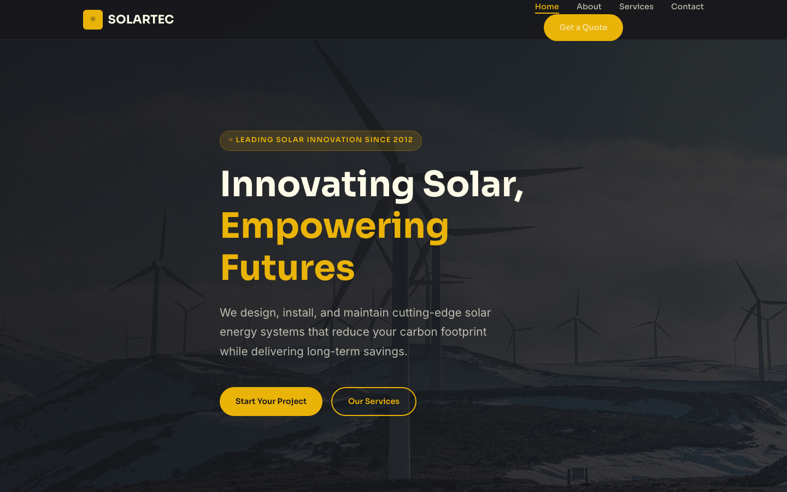

# SOLARTEC — Innovating Solar, Empowering Futures

> Advanced solar technology solutions for a sustainable tomorrow.

**SOLARTEC** is a bold, energy-focused template for solar companies, clean-tech startups, and renewable energy consultants. Built with high-contrast yellow-on-dark design, strong typography, and a gallery-rich layout, it communicates power, innovation, and environmental responsibility.

---

## 🔗 Live Pages

| Page | Description |
|------|-------------|
| [Home](index.html) | Hero with carousel, services overview, stats counter, testimonials |
| [About](about.html) | Company story, mission/values, team profiles, gallery |
| [Services](services.html) | Detailed service offerings with images and descriptions |
| [Contact](contact.html) | Contact form with validation, office locations, map placeholder |

---

## 📸 Screenshot



## 🎨 Design System

| Token | Value |
|-------|-------|
| **Primary** | Yellow `#EAB308` |
| **Dark** | Zinc `#18181B` |
| **Body Font** | Sora (400–700) |
| **UI Font** | Inter (300–700) |
| **Layout** | CSS Grid + Flexbox, `clamp()` fluid type |
| **Motion** | IntersectionObserver reveals, `prefers-reduced-motion` safe |

---

## 🛠 Tech Stack

- **HTML5** — semantic markup, accessible forms
- **CSS3** — custom properties, Grid, Flexbox, `clamp()`, `aspect-ratio`
- **Vanilla JS** — IntersectionObserver scroll reveals, mobile nav toggle, form validation, back-to-top
- **No frameworks** — zero dependencies, instant load

---

## 📁 File Structure

```
solar-technology-html-template/
├── index.html
├── about.html
├── services.html
├── contact.html
├── assets/
│   ├── css/
│   │   └── style.css
│   ├── js/
│   │   └── main.js
│   └── img/
│       ├── about.jpg
│       ├── carousel-1.jpg – carousel-3.jpg
│       ├── gallery-1.jpg – gallery-6.jpg
│       ├── team-1.jpg – team-3.jpg
│       └── img-600x400-1.jpg – img-600x400-6.jpg
└── README.md
```

---

## ⚡ Quick Start

1. Open `index.html` in any browser — no server required
2. All assets are local — works completely offline
3. Edit `assets/css/style.css` to customize the design system
4. Replace images in `assets/img/` with your own

---

## 📱 Responsive Breakpoints

| Breakpoint | Layout |
|------------|--------|
| `≥ 980px` | Full desktop — multi-column grids |
| `720px – 979px` | 2-column layout, condensed grids |
| `< 720px` | Single column, hamburger drawer nav |

---

## ✨ Key Features

- **Energy-focused design** — bold yellow-on-dark palette evokes solar power
- **Gallery-rich** — 6 gallery images + 6 carousel images for visual impact
- **SEO-ready** — semantic HTML, meta descriptions, proper heading hierarchy
- **Accessible** — ARIA labels, keyboard navigation, reduced-motion support
- **Performance** — zero dependencies, lazy-loaded images, minimal DOM

---

## 🚀 Deployment

Drop into any static host:

- **GitHub Pages** — push to a repo, enable Pages
- **Netlify / Vercel** — drag and drop the folder
- **Any web server** — upload via FTP or SFTP

---

## Let's Build Something Together 🚀

Want a custom version of this template or a full website built for your business?

**[Start a project →](https://tally.so/r/q4q1L9)**
