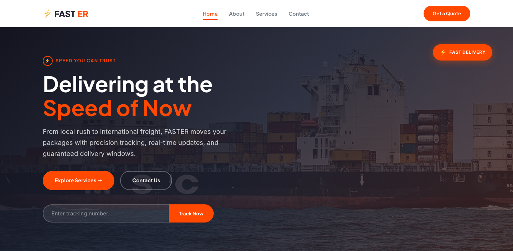

# Express Delivery HTML Template — FASTER

A premium, framework-free HTML template built for express delivery and logistics companies. Speed-branded identity with an orange-and-navy palette, lightning bolt motif, and animated micro-interactions that reinforce the "fastest delivery" positioning.

## 📸 Screenshot

## Pages

| Page | File | Purpose |
|------|------|---------|
| Home | `index.html` | Hero with carousel, service cards, stats, testimonials, CTA |
| About | `about.html` | Company story, mission/vision, team, core values |
| Services | `services.html` | Detailed service cards, transparent pricing, process steps |
| Contact | `contact.html` | `data-form` contact with info cards, validation, success/error states |

## Design Distinction — 6-Axis

| Axis | Expression |
|------|-----------|
| **Color** | Bold `#FF4800` orange on deep `#1F1F2E` navy — high contrast, energy-forward, unmistakable on any device |
| **Typography** | Plus Jakarta Sans (headings, 800 weight) paired with Inter (body) — geometric authority meets clean readability |
| **Motion** | IntersectionObserver reveals at 0.12 threshold, badge bounce animations, card hover transforms, pulse-glow keyframes |
| **Layout** | CSS Grid + clamp() fluid spacing, max-width 1200px, 3-col service cards, responsive 2-col story grids |
| **Texture** | Subtle gradient overlays on hero images, dashed step connectors, orange pill badges, layered box shadows |
| **Identity** | Lightning bolt `&#9889;` glyph woven into logo, icons, stats, and CTAs — a single visual thread that screams speed |

## Features

- **Zero dependencies** — pure HTML, CSS, vanilla JavaScript. No frameworks, no build step.
- **Custom properties design system** --color, --radius, --shadow, --transition tokens for easy theming.
- **Responsive** — breakpoints at 980px (grid collapse) and 720px (burger mobile nav with overlay).
- **Burger toggle** — accessible mobile navigation with `aria-expanded` and click-outside-to-close overlay.
- **Active nav highlighting** — current page gets `.active` class with animated underline.
- **Data year** — `[data-year]` elements auto-populate with the current year via JS.
- **IntersectionObserver reveals** — `.reveal` elements animate in at 0.12 threshold; respects `prefers-reduced-motion`.
- **Testimonial carousel** — multi-slide track with dot navigation, prev/next buttons, auto-advance with pause on hover.
- **Contact form (`data-form`)** — client-side required-field validation, `.form-ok` success, `.form-err` error messages, auto-dismiss.
- **Back-to-top button** — appears after 400px scroll, smooth-scrolls to top.
- **Image-light** — only 6 images in `assets/img/`, reused strategically across all 4 pages. No external image dependencies.
- **Google Fonts** — Inter + Plus Jakarta Sans loaded via Google Fonts CDN with `preconnect`.

## Image Assets

All images live in `assets/img/`:

| File | Used On |
|------|---------|
| `carousel-1.jpg` | Home hero, Services express card |
| `carousel-2.jpg` | (Reserved for carousel variation) |
| `about-1.jpg` | Home about section, About story, Services standard card |
| `about-2.jpg` | Services international card |
| `team-1.jpg` | About team section (3 members) |
| `testimonial-1.jpg` | Home testimonials (3 slides) |

## Tech Stack

- **HTML5** semantic markup
- **CSS3** custom properties, grid, flex, clamp(), cubic-bezier transitions
- **Vanilla JS** IIFE, IntersectionObserver, event delegation
- **Google Fonts** Inter + Plus Jakarta Sans

## Getting Started

1. Open `index.html` in any browser — no server required.
2. Replace images in `assets/img/` with your own.
3. Edit text content, pricing, and contact details.
4. Customize `assets/css/style.css` by changing the `:root` custom properties.

## CTA

Let's Build Something Together :rocket: https://tally.so/r/q4q1L9
