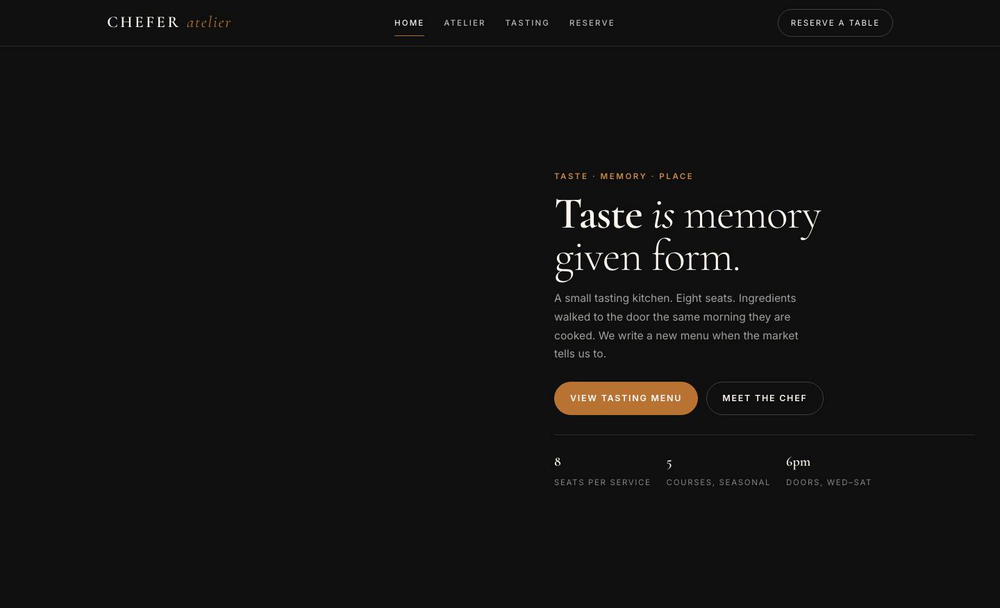

# Chef Portfolio HTML Template — CHEFER

Premium framework-free HTML template for the chef and fine-dining portfolio — a small tasting kitchen told as taste, memory and place. No build step, no framework, no dependencies: hand-authored HTML, a single design-system stylesheet and vanilla JavaScript.

Built for a chef who cooks for eight at one oak board, writes the menu after the market walk, and serves what arrived that morning. The template carries that intimacy into every page: dark ink headers, warm cream surfaces, copper accents, and the plate-reveal — a circle clip that opens like a dish being set down.

## 📸 Screenshot



## Pages

| Page | File | Description |
|------|------|-------------|
| Home | [index.html](index.html) | Hero with plate-reveal dish, masonry pass, chef teaser, press quotes |
| Atelier | [about.html](about.html) | Story, philosophy and quote, 3-chef team, approach (walk → hearth → table) |
| Tasting | [menu.html](menu.html) | Five-course tasting menu as numbered `.courses` + gallery supplement |
| Reserve | [contact.html](contact.html) | Reservation request via `.reserve-grid` with `[data-form]` validation, hours & address, testimonials |

## Design Distinction

CHEFER is positioned against its portfolio siblings as the *tasting-kitchen-as-memoir* — intimate, fire-led and plate-first. Every axis is set to maximise divergence.

| Axis | CHEFER (this template) | Siblings — SUCRÉ / FORGE / MERIDIAN / others |
|------|------------------------|-----------------------------------------------|
| **Hero composition** | **Asymmetric 1.05 / 0.95 split**: left is a full-bleed dish plate with gradient overlay and `plate-reveal` circle wipe; right is editorial copy with three KPI stats. Chef-forward, dish-as-hero. | SUCRÉ: centred confection hero with pastel boxed product. FORGE: full-width industrial yard/steel. MERIDIAN: panoramic landscape/expedition. All centre-weighted, none dish-led. |
| **Layout grammar** | **Numbered course grid** (`72px / 1fr / 160px` with `.course-num` serif numerals) and **masonry pass** (`columns: 3`) as primary storytelling devices; dark/light section alternation (ink → cream → ink → cream). | SUCRÉ: card grid bakery. FORGE: bento/masonry of forged objects. MERIDIAN: horizontal scrollytelling. None use a numbered editorial menu or masonry-as-pass. |
| **Typography personality** | **Cormorant Garamond** (light 300 / semibold 600 + italic) for every heading/quote/numeral paired with **Inter** (300–600) for body, smallcaps and labels. Poetic, high-contrast, memoir-like. | SUCRÉ: rounded display + script. FORGE: condensed grotesk / mono. MERIDIAN: stark neo-grotesk. CHEFER is the only serif-italic, literary voice. |
| **Color logic** | **Ink #0F0F0F + Cream #FFF8F0 + Copper #B87333 + Sage #7A9E7E.** Dark chrome (header, hero, chef/CTA sections) against warm paper; copper as active/price/accent, sage as success. Hearth-and-paper palette. | SUCRÉ: blush/pistachio pastels. FORGE: charcoal/orange/steel. MERIDIAN: navy/teal/ice. No sibling uses ink-cream-copper-sage. |
| **Motion signature** | **Plate-reveal circle wipe** (`clip-path: circle(0% → 75%)` over 0.8s `cubic-bezier(.4,0,.2,1)`) + `reveal` translateY fade, both triggered by a single `IntersectionObserver` (threshold 0.14). The plate literally arrives. | SUCRÉ: soft pop/bounce. FORGE: hard slide/parallax. MERIDIAN: scroll-linked pin. None use a radial plate reveal. |
| **Section inventory** | **Tasting menu (.courses) + chef-grid with badge + masonry pass + reserve-grid (form + hours) + press 3-col quotes.** Content is courses, hearth and the eight-seat table. | SUCRÉ: product/shop/testimonials. FORGE: forge/process/commissions. MERIDIAN: itineraries/map/journal. CHEFER is the only course-led, table-led inventory. |

**Divergence: 6 / 6 axes.** No axis shares a sibling's choice.

## Features

- Framework-free: HTML + single `assets/css/base.css` + `assets/js/main.js` (vanilla JS only)
- Sticky dark header with copper `is-active` underline (set via `location.pathname`), burger with `aria-expanded`
- Hero `1.05 / 0.95` with `plate-reveal` circle and hero KPIs
- Numbered `.courses` tasting menu (5 courses, `72px / 1fr / 160px`)
- Chef-grid with portrait + floating badge, philosophy quote, feature icons
- Masonry gallery and 3-col press quotes
- Reservation form on `.reserve-grid` using `[data-form]` + `.form-ok` / `.form-err` (no `alert()`)
- `IntersectionObserver` reveals, `prefers-reduced-motion` safe, `data-year` auto-year, fully responsive

## File Structure

```
chef-portfolio-html-template/
├── index.html
├── about.html
├── menu.html
├── contact.html
├── assets/
│   ├── css/
│   │   └── base.css          # Entire design system — no additional stylesheet
│   ├── js/
│   │   └── main.js           # Burger, active nav, reveals, form validation, year
│   └── img/
│       ├── about.jpg / about-round.jpg
│       ├── feature-1..3.png
│       ├── hero-1..3.jpg
│       ├── menu-1..8.jpg
│       ├── team-1..3.jpg
│       └── testimonial.jpg / testimonial-1..2.jpg
└── README.md
```

## Customization

- **Colors & type:** edit `:root` tokens in `assets/css/base.css` (`--ink`, `--cream`, `--copper`, `--sage`) and the Google Fonts import (Cormorant Garamond + Inter).
- **Copy & menu:** edit the five `.course` articles in `menu.html` (numeral, title, description, image) and the hero overlay / KPI row. Keep `assets/img/menu-*.jpg` or swap with same-filename originals.
- **Team:** replace the three cards in `about.html`; images are `assets/img/team-*.jpg`.
- **Form:** `contact.html` uses `[data-form]` — required fields, email regex and `.form-ok` / `.form-err` are handled in `assets/js/main.js`. Wire `submit` to your endpoint by replacing the success branch; do not introduce `alert()`.
- **Navigation:** `href` values must remain `index.html`, `about.html`, `menu.html`, `contact.html` — active state is derived from `location.pathname` in `main.js`.
- **Images:** all visuals are local `assets/img/` with `loading="lazy"` where appropriate. Do not add external image hosts.

## Credits

- **Design & code:** CHEFER atelier template — bespoke, framework-free.
- **Type:** [Cormorant Garamond](https://fonts.google.com/specimen/Cormorant+Garamond) & [Inter](https://fonts.google.com/specimen/Inter) via Google Fonts.
- **Photography:** original `assets/img/` set (22 images) — hearth, plates, team and table. No stock placeholders.
- **No dependencies:** no jQuery, no Bootstrap, no build tool.

---

Let's Build Something Together 🚀
https://tally.so/r/q4q1L9
