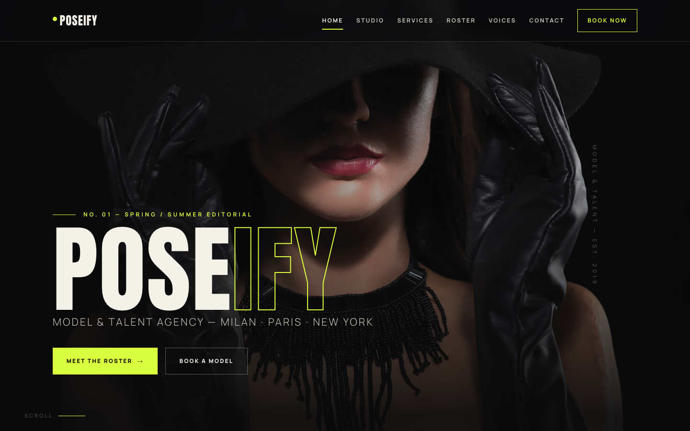

# POSEIFY — Model & Talent Agency

**An international model & talent agency for runway, editorial, commercial and beauty — built as a premium, framework-free HTML template.**

Poseify is a dark, editorial "night runway" brand: deep ink canvas, bone-white type, one acid-yellow strike, giant condensed display typography, full-bleed portrait imagery and sharply asymmetric grids. It ships as a complete, marketplace-ready 7-page static website with a token-driven CSS design system and a single vanilla JS file powering reveals, the mobile menu, the hero crossfade and form feedback.

---

## 📸 Screenshot

## Design System

| Token | Value | Role |
|---|---|---|
| `--bg` | `#0a0a0b` | Deep ink canvas |
| `--bg-soft` | `#101013` | Raised panels |
| `--bg-card` | `#151518` | Card surfaces |
| `--bone` | `#f4f1e8` | Primary type — warm bone |
| `--bone-dim` | `#c9c5b9` | Secondary type |
| `--muted` | `#8f8b80` | Tertiary / meta type |
| `--acid` | `#d9ff3f` | Signature accent — acid yellow |
| `--acid-dim` | `#b7e02e` | Accent hover |
| `--line` | `rgba(244,241,232,.14)` | Hairline borders |
| `--display` | `Anton` | Condensed all-caps display |
| `--sans` | `Manrope` | Minimal grotesque body |
| `--fs-hero` | `clamp(4rem, 15vw, 12.5rem)` | Cover hero size |
| `--fs-h2` | `clamp(2.4rem, 6vw, 5rem)` | Section headlines |
| `--gutter` | `clamp(1.1rem, 4vw, 3.2rem)` | Fluid container gutters |
| `--ease` | `cubic-bezier(.22, 1, .36, 1)` | Motion signature |

**Motion signature:** IntersectionObserver scroll reveals with stagger, a CSS marquee ticker, a 6-second crossfading cover hero, hover zoom with grayscale-to-color lifts, and a scroll-triggered back-to-top button.

**Responsive:** fluid `clamp()` type throughout; breakpoints at `~1080px`, `~980px` (burger menu) and `~720px` (single column).

---

## Pages

| Page | Description |
|---|---|
| [index.html](index.html) | Editorial cover hero with crossfade, marquee, featured studio story, services index, roster preview, stats, testimonial preview and client wordmarks |
| [about.html](about.html) | The studio manifesto, split story, values grid, agency timeline and stats |
| [service.html](service.html) | Four castable disciplines (runway, editorial, commercial, management) with process steps and CTA |
| [team.html](team.html) | The model roster — eight full-bleed faces with hover stories, measurements and booking CTA |
| [testimonial.html](testimonial.html) | Voices from casting directors, creative studios and fashion editors, plus client wordmarks |
| [contact.html](contact.html) | Studio info panel, validated contact form, FAQ accordion |
| [404.html](404.html) | Editorial 404 with recovery navigation |

---

## Tech Stack

- **HTML5** — semantic, accessible, valid markup
- **CSS3** — token-driven design system with custom properties, Grid, Flexbox, `clamp()` and `aspect-ratio`
- **Vanilla JS** — one canonical `assets/js/main.js` (IntersectionObserver reveals, mobile nav, active links, hero crossfade, forms, back-to-top, smooth anchors)
- **Google Fonts** — Anton + Manrope (loaded from `fonts.googleapis.com` / `fonts.gstatic.com` only)
- **No frameworks** — no Bootstrap, Tailwind, React or any other CDN dependency

---

## Images

All imagery is original and bundled locally in `assets/img/`:

| File | Use |
|---|---|
| `carousel-1.jpg`, `carousel-2.jpg` | Home hero crossfade |
| `Poseify.jpg` | Featured editorial story |
| `about.png` | About page studio portrait |
| `service-1.jpg` … `service-4.jpg` | Services cards |
| `team-1.jpg` … `team-8.jpg` | Model roster |
| `testimonial-1.jpg` … `testimonial-3.jpg` | Testimonial avatars |
| `footer-bg.png` | Footer campaign band |

---

## SEO

- Unique `title` and `meta description` per page
- Semantic heading hierarchy, alt text on all images
- Open Graph tags on primary pages

**Keywords:** model agency, modeling agency, fashion talent, runway casting, editorial models, beauty campaign, menswear models, talent management, booking agency, Milan fashion.

---

## License

Free to use for personal and commercial projects. Attribution appreciated but not required. All model images are for template demonstration purposes.

---

### Let's Build Something Together 🚀

[https://tally.so/r/q4q1L9](https://tally.so/r/q4q1L9)
