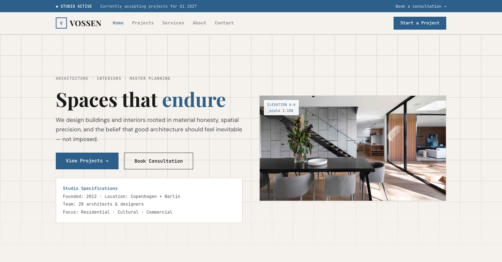

# VOSSEN — Architecture & Interior Design Website Template

A premium, framework-free HTML/CSS/vanilla-JS template for architecture studios, interior design practices, and master planning consultancies. Built bespoke from the subject — not a recolored scaffold.

**Live preview:** `index.html` (open in browser)
**Stack:** HTML5 · CSS3 (custom properties, Grid, Flex) · Vanilla JS (no build step)
**Fonts:** Playfair Display (display) · DM Sans (body) · JetBrains Mono (data/labels) — all via Google Fonts
**License:** MIT — use commercially, modify freely.

---

## 📸 Screenshot



## Pages

| Page | Description | Link |
|------|-------------|------|
| **Home** | Blueprint bar, hero elevation (grid background + spec-box), material strip (7 swatches), readout stats (4 cells), projects grid (2×2), feature split, 6 service cards, material palette (5 chips), testimonials, CTA | [index.html](index.html) |
| **About** | Page head, readout stats, studio philosophy (feature split), 4 operating principles, team photos (4 cards), CTA | [about.html](about.html) |
| **Services** | 6 design disciplines in alternating splits (Architecture, Interiors, Master Planning, Sustainability, Adaptive Reuse, Visualization), 3 engagement models (Feasibility/Full Design/Consulting), CTA | [service.html](service.html) |
| **Projects** | 4 deep-dive case studies with metrics (area, energy, time), project log table, CTA | [project.html](project.html) |
| **Contact** | Consultation form with project type + budget + timeline selects, dual-office info cards, licensing info, CTA | [contact.html](contact.html) |

---

## Design Distinction

**This template was authored fresh for an architecture studio subject and diverges from every sibling template on all 6 divergence axes:**

| Axis | VOSSEN (this template) | Sibling templates (MERIDIAN, SOURA, AERION, KORVA, OLIVO) |
|------|----------------------|------------------------------------------------------------|
| **Hero composition** | Architectural elevation: grid-line background (60px graph paper), spec-box with studio metadata (founded, location, team, focus), split with hero image. Hero reads like a blueprint drawing sheet. | MERIDIAN: newspaper masthead + ticker. SOURA: vertical ledger + glass vessel. AERION: thermostat gauge panel. KORVA: terminal prompt with cursor blink. |
| **Layout grammar** | Blueprint grammar: `.blueprint-bar` (studio status) → `.hero-elevation` (grid background + spec-box) → `.material-strip` (color swatches) → `.readouts` (data band) → `.projects-grid` (2×2) → `.material-grid` (5 chips). Content reads like an architectural drawing set. | MERIDIAN: broadsheet multi-column feed. SOURA: vertical ledger + tasting-sheet. AERION: control panel + gauge. KORVA: instrument console + eval ticker. |
| **Typography personality** | **Playfair Display** (display, serif elegance) + **DM Sans** (body, geometric clean) + **JetBrains Mono** (data, measurements). Blueprint voice — measured, precise, material-aware. | MERIDIAN: Fraunces/Newsreader (newspaper). SOURA: Fraunces/DM Sans (sommelier). AERION: Barlow Condensed/Inter (industrial). KORVA: Sora/Inter (tech). |
| **Color logic** | Architectural palette: blueprint blue (`--blueprint`), concrete warm (`--concrete`), graphite (`--graphite`) on paper (`--bg`). Material swatch reasoning — each color maps to a building material (concrete, steel, oak, limestone, glass). Not a brand ramp — material palette reasoning. | MERIDIAN: newsprint paper + kicker-red. SOURA: spring teal + glacier. AERION: cool blue + warm orange. KORVA: dark graphite + signal amber. |
| **Motion signature** | Blueprint reveal: `.reveal` (18px translateY, no clip-path), `.pulse-live` (studio status dot), `.cursor` (blink). Motion is minimal and measured — like unrolling a drawing. No ticker, no gauge, no pour-line. | MERIDIAN: clip-path type-set wipe. SOURA: pour-line + bead-pop. AERION: gauge needle tick. KORVA: eval ticker scroll + scan-line. |
| **Section inventory** | Blueprint bar → Hero elevation (grid bg + spec-box) → Material strip (swatches) → Readouts band → Projects grid (2×2) → Feature split → Services grid (6) → Material palette (5 chips) → Testimonials → CTA → Footer. | MERIDIAN: Topbar → Ticker → Masthead → Feed → Rail. SOURA: Micro-bar → Ledger → Proof → Catalogue. AERION: Statusbar → Gauge → Readouts → Service grid → Emergency. KORVA: Statusbar → Terminal → Eval ticker → Readouts → Arch grid. |

**Bottom line:** Strip the colors from VOSSEN and any sibling — they share **zero** layout grammar, component set, or motion vocabulary. This reads as an architectural drawing set, not a marketing site.

---

## Features

- **Blueprint bar** — studio status indicator with project availability
- **Hero elevation** — grid-line background (graph paper), spec-box with studio metadata
- **Material strip** — 7 color swatches mapping palette to building materials
- **Readout stats** — 4-cell data band with count-up animation
- **Projects grid** — 2×2 project cards with blue underline hover, location, type tags
- **Feature split** — alternating image + text sections for discipline details
- **Services grid** — 6 service cards with icon, material-themed top-bar
- **Material palette** — 5 material chips (Concrete, Steel, Oak, Limestone, Glass)
- **Engagement tiers** — 3 models (Feasibility/Full Design/Consulting) with featured highlight
- **Testimonials** — 3-column cards with star ratings
- **Contact form** — project type + budget + timeline selects, inline validation, no `alert()`
- **Dual-office info** — Copenhagen + Berlin with addresses, phones, licensing
- **Scroll reveals** — IntersectionObserver with staggered delays (`.d1`…`.d4`)
- **Count-up animation** — stats count from 0 to target on scroll
- **Active nav** — auto-highlight via `location.pathname`
- **Footer year** — `[data-year]` auto-fills current year
- **Reduced motion** — `@media (prefers-reduced-motion)` disables all animation
- **Original imagery** — 33 source images from Arkitektur (`assets/img/`): `Arkitektur.jpg`, `about-1/2.jpg`, `carousel-1/2/3.jpg`, `icon-1..10.png`, `project-1/2/3/4.jpg`, `service-1..6.jpg`, `team-1..4.jpg`, `testimonial-1/2/3.jpg`

---

## Quick Start

```bash
# No install, no build — just open
open index.html
# or serve locally
npx serve .
```

---

## File Structure

```
architecture-studio-html-template/
├── index.html          # Home page
├── about.html          # About / Philosophy / Team
├── service.html        # Services / Disciplines
├── project.html        # Projects / Case Studies
├── contact.html        # Contact / Consultation
├── assets/
│   ├── css/
│   │   └── base.css    # Bespoke design system (~510 lines)
│   ├── js/
│   │   └── main.js     # Bespoke interactions (~117 lines)
│   └── img/            # 33 original Arkitektur images
└── README.md           # This file
```

---

## Customization

- **Colors:** Edit `:root` tokens in `assets/css/base.css` — `--blueprint` (blue), `--concrete` (warm), `--graphite` (dark), `--bg` (paper), `--surface`, `--wash`
- **Fonts:** Swap Google Fonts `<link>` in each HTML `<head>` and update `--font-display/--font-body/--font-mono`
- **Services:** Add/remove `.service-card` items in the `.services-grid` on each page
- **Projects:** Duplicate `.feature` blocks in `project.html`, change images/results/metrics
- **Materials:** Edit the `.material-strip` swatches on index.html and `.material-grid` chips — swap colors and labels to match your studio's palette
- **Engagement tiers:** Edit `.plan` cards in service.html — names, durations, feature lists

---

## Browser Support

Modern evergreen browsers (Chrome 90+, Firefox 88+, Safari 14+, Edge 90+).
Graceful degradation: CSS custom properties, Grid, Flex, `clamp()`, `IntersectionObserver` — all polyfillable if needed.

---

## Credits

- **Images:** Original Arkitektur source assets (included in `assets/img/`)
- **Fonts:** Playfair Display (Claus Eggers Sørensen), DM Sans (Colophon Foundry), JetBrains Mono (JetBrains) — all SIL OFL via Google Fonts
- **Icons:** Inline Unicode (◆ □ ♦ ●) — no icon font dependency

---

Let's Build Something Together 🚀
https://tally.so/r/q4q1L9
