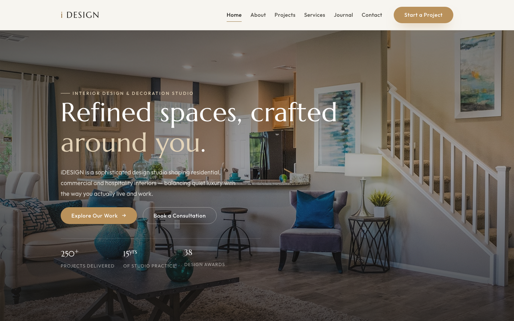

# iDESIGN — Interior Design & Decoration Studio HTML Template

A sophisticated, fully responsive HTML template for interior design and decoration studios. iDESIGN ships as eight complete pages — handcrafted with pure HTML, CSS and vanilla JavaScript, and powered by an original set of 21 studio photographs. No frameworks, no build step, no image placeholders: open the folder, and it runs.

The design language is one of quiet luxury — a warm charcoal, brass and sage palette, elegant Marcellus serif headlines paired with the Outfit sans, generous spacing and scroll-reveal motion. Every component is token-driven, so you can re-skin the whole studio in minutes by editing a single CSS file.

---

## 📸 Screenshot

## Design System

The entire visual language is defined as CSS custom properties in `assets/css/style.css`. Change a token once and the whole template follows.

| Token group | Token | Value | Role |
| --- | --- | --- | --- |
| Color | `--clr-ink` | `#23221f` | Charcoal — primary text |
| Color | `--clr-ink-soft` | `#4c4a44` | Secondary text |
| Color | `--clr-ink-faint` | `#7d7a72` | Muted/tertiary text |
| Color | `--clr-brass` | `#b9915b` | Primary accent (buttons, hover) |
| Color | `--clr-brass-deep` | `#9a7745` | Accent hover, links |
| Color | `--clr-brass-pale` | `#e3d3b8` | Hairlines, dark-surface accents |
| Color | `--clr-sage` | `#7d8a6e` | Nature accent |
| Color | `--clr-sage-deep` | `#5c6a4e` | Icon fills on dark surfaces |
| Color | `--clr-sage-pale` | `#e4e8da` | Tinted surfaces, success alerts |
| Color | `--clr-porcelain` | `#f7f5f0` | Page background |
| Color | `--clr-cream` | `#efece3` | Alt section background |
| Color | `--clr-charcoal-900` | `#171614` | Near-black warm — footer, dark bands |
| Typography | `--font-serif` | `'Marcellus'` | Display & headings |
| Typography | `--font-sans` | `'Outfit'` | Body & UI |
| Type scale | `--fs-hero` | `clamp(2.6rem, 6vw, 4.6rem)` | Hero titles |
| Type scale | `--fs-display` | `clamp(2.2rem, 4.5vw, 3.6rem)` | Page-hero / band titles |
| Type scale | `--fs-title` | `clamp(1.7rem, 3vw, 2.4rem)` | Section titles |
| Type scale | `--fs-body` | `1.0625rem` | Body copy |
| Layout | `--container` | `1180px` | Max content width |
| Layout | `--container-narrow` | `820px` | Reading / form width |
| Layout | `--header-h` | `84px` | Sticky header height |
| Radius | `--radius-lg` | `18px` | Card corners |
| Motion | `--ease-out` | `cubic-bezier(0.22, 1, 0.36, 1)` | Reveal & hover easing |

---

## Pages

All eight pages share the same sticky header, footer, back-to-top control and reveal animation — consistent by construction.

| # | Page | Description |
| --- | --- | --- |
| 1 | [Home](https://uiuxlabz.github.io/interior-design-html-template/) | Hero carousel, featured project, stats band, portfolio, services preview, testimonials, team and journal |
| 2 | [About](https://uiuxlabz.github.io/interior-design-html-template/about.html) | Studio story, philosophy cards, team grid |
| 3 | [Projects](https://uiuxlabz.github.io/interior-design-html-template/projects.html) | Filterable project portfolio grid |
| 4 | [Services](https://uiuxlabz.github.io/interior-design-html-template/services.html) | Six service disciplines plus the four-stage process |
| 5 | [Journal](https://uiuxlabz.github.io/interior-design-html-template/blog.html) | Article listing with featured post |
| 6 | [Article](https://uiuxlabz.github.io/interior-design-html-template/blog-single.html) | Full article with prose styling and sidebar |
| 7 | [Contact](https://uiuxlabz.github.io/interior-design-html-template/contact.html) | Enquiry form with validation states and studio info cards |
| 8 | [404](https://uiuxlabz.github.io/interior-design-html-template/404.html) | On-brand error page |

---

## Tech Stack

- **HTML5** — semantic, accessible, SEO-ready (Open Graph + description meta on every page)
- **CSS3** — a single token-driven stylesheet (`assets/css/style.css`) with responsive breakpoints and `prefers-reduced-motion` support
- **Vanilla JavaScript** — one 76-line file (`assets/js/main.js`) powering reveal-on-scroll, the mobile nav, active-link highlighting, the hero crossfade, the contact form, the year stamp and back-to-top
- **Google Fonts** — Marcellus + Outfit (loaded from `fonts.googleapis.com` / `fonts.gstatic.com` only)
- No frameworks, no libraries, no CDNs beyond Google Fonts

## Images

21 original studio photographs ship in `assets/img/` — hero carousels, portfolio pieces, team portraits, blog headers and testimonial avatars. Every image is referenced by its real filename and paired with descriptive `alt` text. No placeholder services, no external image dependencies.

## SEO

Target keywords baked into the copy and meta: interior design studio, interior decoration, residential interior design, commercial interiors, lighting design, decoration and styling, renovation and remodel, turnkey interior delivery, hospitality design, workspace design, New York interior designer.

## License

Free for personal and commercial use. Attribution to uiuxlabz is appreciated but not required. You may modify, extend and resell the template — just don't resell it as a plain copy.

---

### Let's Build Something Together 🚀

[https://tally.so/r/q4q1L9](https://tally.so/r/q4q1L9)
