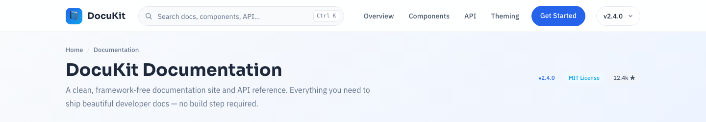

# 📘 DocuKit — Software Documentation &amp; API Reference HTML Template

A clean, framework-free documentation site and API reference. Sticky sidebar navigation, a mini table of contents, syntax-highlighted code blocks with one-click copy, a components gallery, a responsive grid demo, theming tokens, and an API endpoint table — all in pure HTML5, CSS3 and vanilla JavaScript. No frameworks, no build tools, no dependencies.

## 📸 Screenshot

## Design System

| Token | Value | Usage |
|-------|-------|-------|
| --slate | `#1E293B` | Headings & dark surfaces |
| --blue | `#2563EB` | Primary accent, links, CTAs |
| --sky | `#0EA5E9` | Secondary accent, gradients |
| --light | `#F8FAFC` | Page background |
| --white | `#FFFFFF` | Cards & panels |
| --gray | `#64748B` | Body copy, muted text |
| --line | `#E2E8F0` | Borders & dividers |
| --code | `#0F172A` | Code block background |
| --font-heading | Sora (600/700) | Headings |
| --font-body | IBM Plex Sans (400/500) | Body copy |

## Pages

| Page | Description |
|------|-------------|
| [index.html](index.html) | Single-page documentation with anchor sections: Getting Started, Installation, Usage, Components, Responsive Grid, Theming, API Reference, Accessibility |
| [404.html](404.html) | Not-found page with gradient 404 and quick links back into the docs |

## Tech Stack

- **Semantic HTML5** — header, nav, main, aside, footer landmarks
- **CSS custom properties** — full design-token system in `:root`
- **Vanilla JavaScript** — scrollspy, mobile drawer, live search filter, copy buttons, reveal animations, mobile nav
- **Responsive** — desktop sidebar, tablet overlay drawer (≤980px), stacked single column (≤720px)
- **Accessible** — ARIA labels, keyboard navigation, visible focus, `prefers-reduced-motion` support

## Images

- `assets/img/bootstrap-documentation-template.png` — full template preview (800×500)
- `assets/img/circle.jpg` — circle avatar component preview (500×400)
- `assets/img/rounded.jpg` — rounded card surface preview (500×400)
- `assets/img/thumbnail.jpg` — thumbnail media preview (500×400)
- `assets/img/pill.jpg` — pill badge preview (500×400)
- `assets/img/responsive.jpg` — responsive grid demonstration (1200×400)

---

**Template by uiuxlabz** — framework-free, responsive, production-ready.

---

### Let's Build Something Together 🚀

[https://tally.so/r/q4q1L9](https://tally.so/r/q4q1L9)
