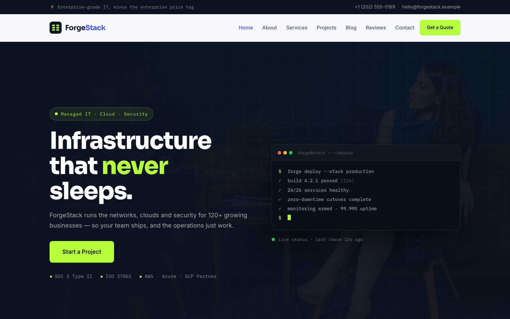

# ForgeStack — IT Solutions &amp; Managed Services Template

A premium, framework-free HTML template for a managed IT and cloud solutions company. Deep navy grounds with electric indigo and terminal-lime accents, driven by Sora display type, IBM Plex Mono technical labels and a live deployment-terminal hero — a calm, engineering-first presence for a firm running infrastructure for 120+ businesses.

## 📸 Screenshot

## Design System

| Token | Value |
|-------|-------|
| **Ground** | `--clr-bg` `#f6f7fa` (light), `--clr-dark` `#0b1220` (deep navy), `--clr-dark-2` `#101a30` |
| **Primary** | `--clr-primary` `#4353ff` (electric indigo), `--clr-primary-deep` `#3441d6` |
| **Accent** | `--clr-accent` `#b6ff3c` (terminal lime), `--clr-accent-deep` `#9ae81f` |
| **Text** | `--clr-ink` `#0e1526`, `--clr-text` `#4b566e`, `--clr-text-light` `#7c879e` |
| **Display type** | `Sora` (sans, 400–800) |
| **Body type** | `Inter` (sans, 400–700) |
| **Mono type** | `IBM Plex Mono` (technical labels, terminal, stats) |
| **Container** | 1200px max-width, centered |
| **Breakpoints** | ~992px (grid collapse), ~768px (mobile nav), ~576px (single column) |

## Pages

| Page | File | Description |
|------|------|-------------|
| Home | [index.html](index.html) | Hero with crossfading background + live deployment-terminal card, trust stack strip, six system-service cards, stats band, ops console split, four-stage pipeline, case-study grid, testimonials, CTA |
| About | [about.html](about.html) | Company story split with uptime console, stats band, values grid |
| Services | [service.html](service.html) | Six fixed-fee services, delivery pipeline on dark ground |
| Projects | [project.html](project.html) | Six case-study cards with result chips |
| Blog | [blog.html](blog.html) | Six field-note posts with mono metadata |
| Reviews | [testimonial.html](testimonial.html) | Six client testimonials, client-scoreboard stats band |
| Contact | [contact.html](contact.html) | Free-audit form with `[data-form]` validation, info cards, map |
| 404 | [404.html](404.html) | On-brand "route returned null" error page with recovery links |

## Features

- **Framework-free** — pure HTML5, CSS3 (custom properties, Grid, Flexbox, `clamp()`), vanilla JavaScript
- **Engineering-first aesthetic** — navy + indigo + terminal lime, mono technical labels, terminal motif
- **Fluid responsive** — three breakpoints, no horizontal scroll on any viewport
- **Scroll reveal** — IntersectionObserver-powered `.reveal` animations (respects `prefers-reduced-motion`)
- **Mobile nav** — burger toggle with `aria-expanded` accessible pattern
- **Hero crossfade** — automatic 6s background image transition via `.hero-bg img` + `.active`
- **Live terminal card** — hero deployment mockup with blinking cursor and status lines
- **Grid overlay** — CSS-patterned engineering grid behind the hero copy
- **System service cards** — corner-bracket tiles with mono index tags and hover glow
- **Deployment pipeline** — four-stage horizontal process with connecting track
- **Console panel** — overlay "monitor" card on split imagery
- **Case-study cards** — project grid with result-chip metrics
- **Contact form** — `[data-form]` hook with `.form-ok` / `.form-err` / `.show` toggle
- **Original imagery** — production IT and infrastructure photography, no placeholders

## Tech Stack

- HTML5 + CSS3 (W3C-valid, semantic landmarks)
- Vanilla JavaScript (canonical IIFE build)
- Google Fonts (Sora + Inter + IBM Plex Mono)
- SVG favicon (inline data: URI)

## SEO

- Semantic HTML5 structure (`<header>`, `<nav>`, `<main>`, `<section>`, `<footer>`)
- Unique `<title>` and `<meta description>` per page
- `lang="en"` attribute, `charset="utf-8"`, viewport meta
- Alt text on all images

## License

Free for personal and commercial use. Attribution appreciated but not required.

---

## Let's Build Something Together 🚀

[Book a free consultation](https://tally.so/r/q4q1L9)
