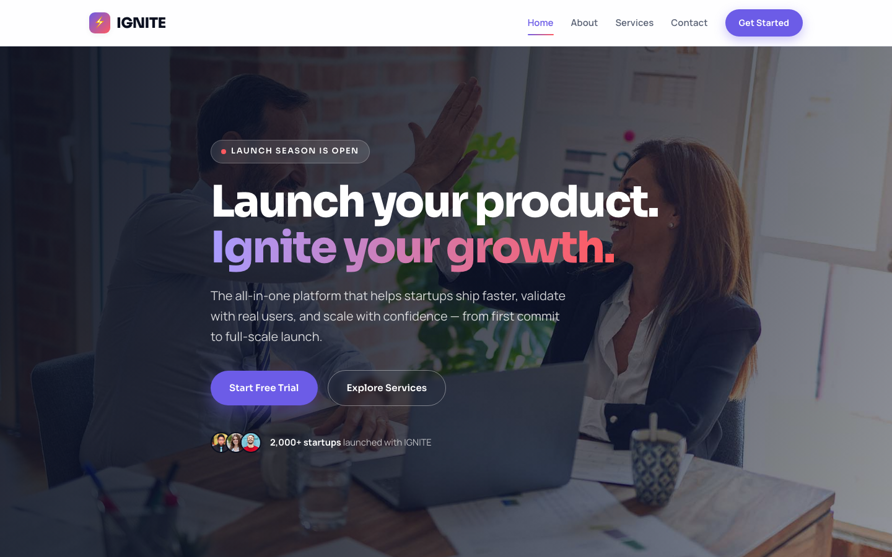

# 🚀 IGNITE — Startup Launch Template

A premium, framework-free HTML template for product-launch platforms and startup services. The design pairs a deep navy ink with electric violet and hot coral accents, geometric Sora display typography, and a full-bleed crossfading hero — a bold, high-energy identity built to sell speed, confidence, and momentum.

## 📸 Screenshot

## 🎨 Design System

| Token | Value | Usage |
|-------|-------|-------|
| `--ink` | `#0B1020` | Deep navy-black, footer, dark sections, hero overlay |
| `--violet` | `#6C5CE7` | Primary CTAs, links, active nav, accents |
| `--coral` | `#FF5A5F` | Highlights, gradients, price tags, stars |
| `--bg` | `#F6F7FB` | Light page background |
| `--card` | `#FFFFFF` | Cards, form fields, nav bar |
| `--muted` | `#5A6275` | Body copy, secondary text |
| `--line` | `#E4E7F0` | Borders, dividers, hairlines |
| Headings | Sora | Geometric modern sans, display weight |
| Body | Manrope | Clean readable humanist sans |

## 📄 Pages

| Page | Description | Sections |
|------|-------------|----------|
| [index.html](index.html) | Home — full-bleed crossfading hero with left-aligned display headline | Logo strip (9 partners), Feature split with checklist, Services grid (6), Stats band, Team (3), Testimonials (4), CTA banner |
| [about.html](about.html) | Our story | Page hero, Story split, Mission & values, Team, CTA banner |
| [services.html](services.html) | Services & pricing | Page hero, Services grid (6), Pricing (3 tiers), FAQ accordion, CTA banner |
| [contact.html](contact.html) | Contact & consultation | Page hero, Contact form (name, email, company, budget, message), Contact info card with hours, CTA banner |

## ⚙️ Tech Stack

- **HTML5** — semantic markup, accessibility-first
- **CSS3** — custom properties, Grid, Flexbox, `clamp()`, `aspect-ratio`
- **Vanilla JS** — IntersectionObserver, hero crossfade, mobile nav, form validation
- **Fonts** — Google Fonts (Sora + Manrope)

## 📁 Images

All images from the original startup template — 19 files in `assets/img/`:

- `carousel-1.jpg`, `carousel-2.jpg` — Hero crossfade (1920×1080)
- `feature.jpg`, `about.jpg` — Feature / story split (800×800)
- `team-1.jpg` through `team-3.jpg` — Team portraits (500×500)
- `testimonial-1.jpg` through `testimonial-4.jpg`, `user.jpg` — Testimonial avatars (100×100)
- `vendor-1.jpg` through `vendor-9.jpg` — Partner logo strip (150×50)

---

**Template by uiuxlabz** — framework-free, responsive, production-ready.

---

### Let's Build Something Together 🚀

[https://tally.so/r/q4q1L9](https://tally.so/r/q4q1L9)
