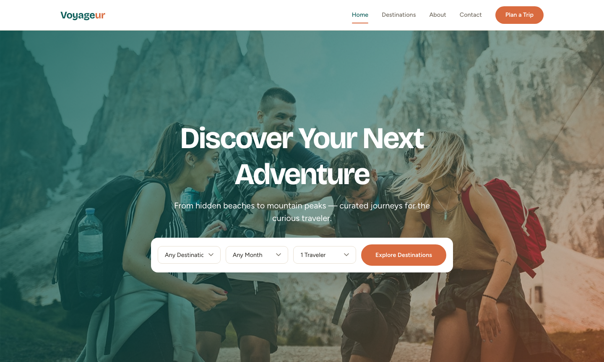

# 🗺️ VOYAGEUR — Tourist Guide Template

A premium, framework-free HTML template for travel guides and destination discovery platforms. The design features a warm sand + terracotta + deep teal palette, bold Bricolage Grotesque headings with Figtree body text, and a full-bleed hero with a quick-search bar — a contemporary, editorial atmosphere built to make travelers feel ready for their next adventure.

## 📸 Screenshot

## 🎨 Design System

| Token | Value | Usage |
|-------|-------|-------|
| `--sand` | `#F6EFE4` | Page background, soft section backgrounds |
| `--terra` | `#D96B3F` | CTAs, highlights, tags, accent elements |
| `--teal` | `#0E5E5A` | Headings, nav, page heroes, footer, primary |
| `--ink` | `#24211B` | Body text, dark tips band |
| `--card` | `#FFFFFF` | Cards, form inputs, nav background |
| `--muted` | `#6E675C` | Secondary text, labels |
| `--line` | `#E7DECE` | Borders, dividers |
| Headings | Bricolage Grotesque | Bold contemporary display sans-serif |
| Body | Figtree | Warm modern geometric sans-serif |

## 📄 Pages

| Page | Description | Sections |
|------|-------------|----------|
| [index.html](index.html) | Home — full-bleed hero with gradient overlay and quick-search bar | Featured destinations grid (mixed aspect ratios), Why choose us, About split, Travel tips band, CTA banner |
| [destinations.html](destinations.html) | Curated travel destinations | Page hero, Filter chips (All/Beaches/Mountains/Cities), 4 destination cards with highlights, best season, duration & price |
| [about.html](about.html) | About the brand | Story split with layered image, Values cards, Stats bar, CTA banner |
| [contact.html](contact.html) | Trip planning & contact | Trip planning form (name, email, destination, date, travelers, budget, notes), Contact info card with hours |

## ⚙️ Tech Stack

- **HTML5** — semantic markup, accessibility-first
- **CSS3** — custom properties, Grid, Flexbox, `clamp()`, `aspect-ratio`
- **Vanilla JS** — IntersectionObserver reveals, mobile nav, active links, form validation, back-to-top
- **Fonts** — Google Fonts (Bricolage Grotesque + Figtree)

## 📁 Images

All original images in `assets/img/` (6 files):

- `bg-hero.jpg` — Homepage hero background (1366×768)
- `about.jpg` — Story / about split (700×700)
- `destination-1.jpg` — Featured destination, wide card (800×300)
- `destination-2.jpg` — Featured destination (600×400)
- `destination-3.jpg` — Featured destination (600×400)
- `destination-4.jpg` — Featured destination, tall card (600×600)

---

**Template by uiuxlabz** — framework-free, responsive, production-ready.

---

### Let's Build Something Together 🚀

[https://tally.so/r/q4q1L9](https://tally.so/r/q4q1L9)
