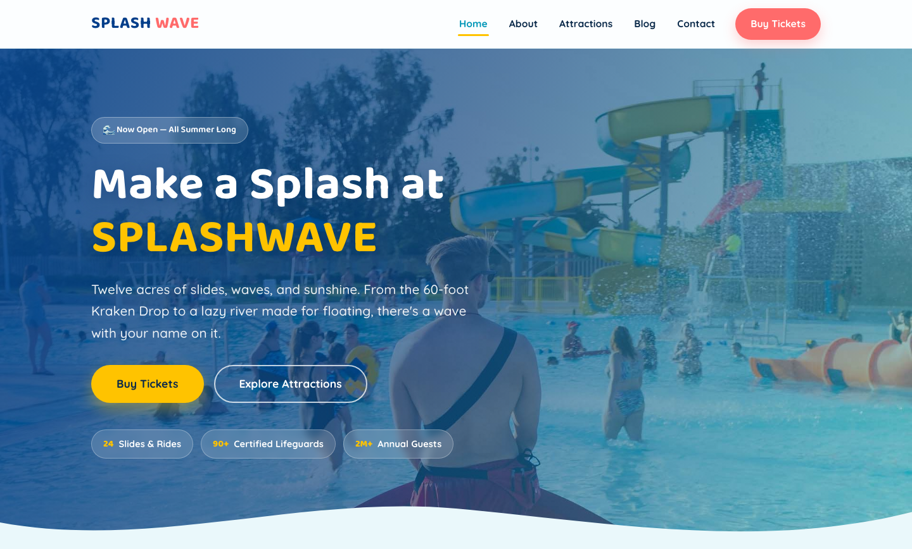

# 🏖️ SPLASHWAVE — Water Park Template

A premium, framework-free HTML template for family water parks and splash destinations. The design features a bright aqua + deep blue palette with sunny yellow and coral accents, playful rounded Baloo 2 typography, and an energetic, splash-filled atmosphere that communicates fun, safety, and all-day family adventure.

## 📸 Screenshot

## 🎨 Design System

| Token | Value | Usage |
|-------|-------|-------|
| `--aqua` | `#00B4D8` | Primary accent, buttons, chips, links |
| `--deep` | `#023E8A` | Headings, dark sections, footer, hero overlay |
| `--sun` | `#FFC300` | Primary CTA buttons, highlights, price tags |
| `--coral` | `#FF6B6B` | Nav CTA, secondary accents, back-to-top |
| `--sky` | `#EAF8FB` | Page background, soft section bands |
| `--ink` | `#0B2A4A` | Body text |
| Headings | Baloo 2 | Playful rounded display font |
| Body | Quicksand | Friendly, readable modern sans |

## 📄 Pages

| Page | Description | Sections |
|------|-------------|----------|
| [index.html](index.html) | Home — full-width crossfading hero over a deep-blue gradient with a signature SVG wave divider | Attractions grid (3), About band, Stats bar, Ticket pricing (3 tiers), Blog preview (3), Lifeguard team (3), Newsletter band, Footer with payment badges |
| [about.html](about.html) | Our story | Story split with park photo, Values cards (4), Team (3), CTA |
| [features.html](features.html) | Attractions & ride details | 3 big attraction cards with safety notes, More amenities icon grid (6), CTA |
| [blog.html](blog.html) | Park news & tips | 3 blog cards, CTA |
| [contact.html](contact.html) | Tickets & contact | Ticket/group enquiry form (name, email, phone, visit date, group size, message), Contact card with hours |

## ⚙️ Tech Stack

- **HTML5** — semantic markup, accessibility-first
- **CSS3** — custom properties, Grid, Flexbox, `clamp()`, `aspect-ratio`
- **Vanilla JS** — IntersectionObserver, hero crossfade, mobile nav, form validation
- **Fonts** — Google Fonts (Baloo 2 + Quicksand)

## 📁 Images

All images from the original water park template — 13 files in `assets/img/`:

- `carousel-1.jpg`, `carousel-2.jpg` — Hero crossfade (1920×1080)
- `feature-1.jpg` through `feature-3.jpg` — Attraction cards (600×500)
- `blog-1.jpg` through `blog-3.jpg` — Blog cards (550×450)
- `team-1.jpg` through `team-3.jpg` — Lifeguard team portraits (300×400)
- `about.jpg` — Story split (600×300)
- `payment.png` — Payment method badges (236×30)

---

**Template by uiuxlabz** — framework-free, responsive, production-ready.

---

### Let's Build Something Together 🚀

[https://tally.so/r/q4q1L9](https://tally.so/r/q4q1L9)
